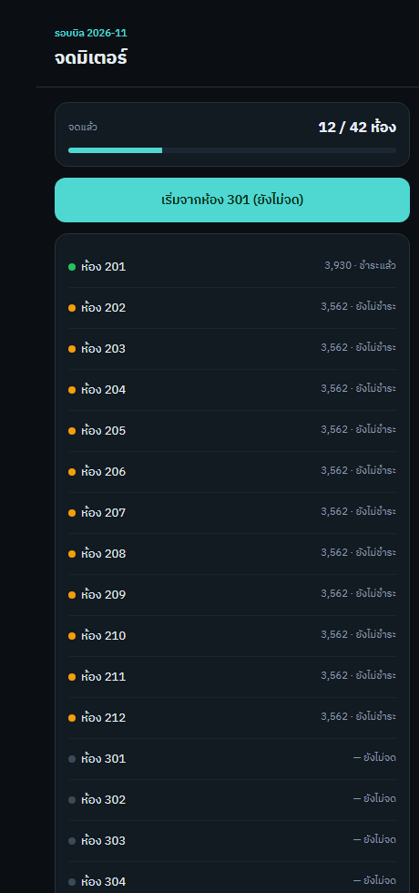

# DomPlus — prototype + frontend

> ระบบออกบิลและทวงค่าเช่าหอพัก ที่เจ้าของแค่จดมิเตอร์

ต้นแบบที่กดเล่นได้จริง + เว็บแอป (เจ้าของ/ผู้เช่า) ที่ต่อกับ API จริงตามสัญญา
ข้อมูลเก็บใน SQLite ของจริง (ไม่ใช่ข้อมูลจำลองในหน้าเว็บ)



## รันในเครื่อง (30 วินาที)

```bash
python server.py
```

| หน้า | URL | ใครใช้ |
|---|---|---|
| เจ้าของหอ | http://127.0.0.1:8777/owner | จดมิเตอร์ · ออกบิล · ดูรายรับ |
| ผู้เช่า | http://127.0.0.1:8777/tenant | ดูบิล · แนบสลิป |
| prototype เดิม (LINE-style) | http://127.0.0.1:8777/ | สาธิตทั้ง flow ในหน้าเดียว |

ไม่ต้องติดตั้งอะไรเพิ่ม — Python 3 standard library ล้วน
บน Windows ดับเบิลคลิก `start-prototype.bat`

## โครงไฟล์

```
server.py          HTTP server + SQLite + seed 42 ห้อง
api_v1.py          adapter /v1/* ตาม docs/API.md
prototype.html     หน้าสาธิต LINE-style (ใช้ /api/*)
web/
  app.css          design tokens (ฟ้า #4FD8D2 / พื้น #0B0F14)
  api.js           API client — แก้ base URL จุดเดียวตอนต่อ backend จริง
  owner.html       หน้าเจ้าของหอ
  tenant.html      หน้าผู้เช่า
db/schema.sql      Postgres DDL (สำหรับ backend จริง)
docs/API.md        สัญญา API + error code + state machine
docs/HANDOFF.md    เอกสารส่งงาน back-end + เกณฑ์ "เสร็จ"
docs/richmenu-*.png  Rich Menu 2500×1686 (เจ้าของ / ผู้เช่า)
```

## ลองตามลำดับนี้ (หน้า /owner)

1. กด **“เริ่มจากห้อง … (ยังไม่จด)”**
2. กรอกเลขน้ำ/ไฟ → ยอดคำนวณสด (น้ำ 25 · ไฟ 7 ต่อหน่วย)
3. กด **“บันทึก แล้วไปห้องถัดไป”** → ระบบพาไปห้องถัดไปเอง
4. กด **“ออกบิลทั้งหอ”** → สร้างใบแจ้งหนี้จริงใน DB
5. เปิด **/tenant** → กด **“แนบสลิป & แจ้งชำระ”** → สถานะเป็น `pending`
6. กลับ /owner → ดูยอดในหน้ารายรับ (ยังไม่ชำระ/รอตรวจ)

## สถานะของแต่ละส่วน

| ส่วน | สถานะ |
|---|---|
| หน้าเจ้าของ + ผู้เช่า (web/) | ✅ ใช้ได้ |
| API `/v1/*` (adapter บน SQLite) | ✅ ใช้ได้ |
| คำนวณบิล · สถานะ · กันบิลซ้ำ | ✅ |
| Backend จริง (FastAPI + Postgres) | ⬜ งานของ back-end |
| LINE OA / LIFF / webhook | ⬜ ต้องมี Channel ID |
| Auth (LINE Login) | ⬜ |
| ตรวจสลิปอัตโนมัติ | ⬜ ตอนนี้เจ้าของกดยืนยันเอง |

## กติกาที่ใส่ไว้ในระบบ

- รอบบิลรายเดือน · ครบกำหนด +5 วันหลังออกบิล
- น้ำ 25 บาท/หน่วย · ไฟ 7 บาท/หน่วย · ค่าเช่า 3,220 (มิเตอร์) / 3,500 (เหมา)
- **ไม่คิดค่าปรับล่าช้า** — ใช้การแจ้งเตือนและสถานะค้างชำระแทน
- ออกบิลซ้ำไม่ได้ (`UNIQUE(room_id, period)`)
- ค่ามิเตอร์น้อยกว่าครั้งก่อน → ขึ้นคำเตือนก่อนบันทึก

## Rich Menu ที่ออกแบบไว้

| เจ้าของหอ | ผู้เช่า |
|---|---|
|  |  |

ขนาด 2500×1686 px (LINE large rich menu)

## เอกสารประกอบ

- [`docs/API.md`](docs/API.md) — สัญญา API ที่ frontend ใช้อยู่
- [`docs/HANDOFF.md`](docs/HANDOFF.md) — งานที่เหลือและเกณฑ์เสร็จสำหรับ back-end
- [`db/schema.sql`](db/schema.sql) — โครงฐานข้อมูล Postgres
