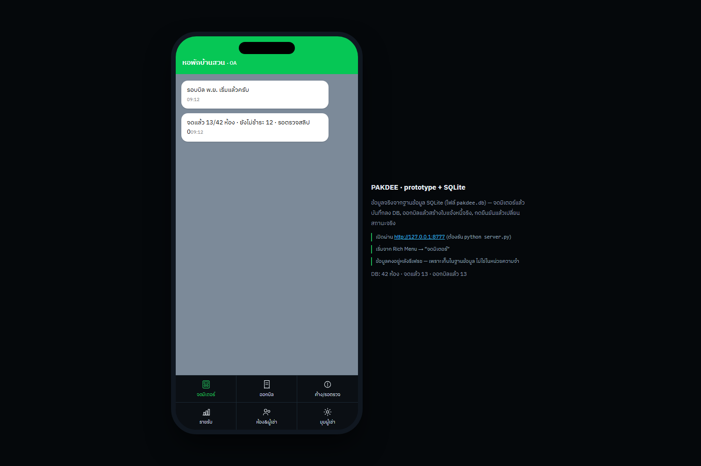

# PAKDEE — prototype ระบบออกบิลและทวงค่าเช่า

ต้นแบบกดเล่นได้จริง + ฐานข้อมูล SQLite ของจริง (ไม่ใช่ข้อมูลจำลองในหน้าเว็บ)



## รันในเครื่อง (30 วินาที)

```bash
python server.py
```

แล้วเปิด http://127.0.0.1:8777

ไม่ต้องติดตั้งอะไรเพิ่ม — ใช้ Python 3 standard library ล้วน (sqlite3 + http.server)

## ลองตามลำดับนี้

1. กด **“จดมิเตอร์”** ที่ Rich Menu ล่างสุด
2. เลือกห้องที่ยังไม่จด → กรอกเลขน้ำ/ไฟ → ยอดคำนวณสด
3. กด **“บันทึก แล้วไปห้องถัดไป”** → ระบบพาไปห้องถัดไปเอง
4. กด **“ออกบิล”** → สร้างใบแจ้งหนี้จริงใน DB (เฉพาะห้องที่จดแล้ว)
5. กด **“มุมผู้เช่า”** → ดูบิล → **แนบสลิป**
6. กลับมุมเจ้าของ → **ยืนยันการชำระ** → ใบเสร็จ
7. กด **“รายรับ”** → ตัวเลขสรุปคำนวณจาก SQL จริง
8. ในแชทเจ้าของ กดการ์ด **“แจ้งเตือน · ค้างชำระ”** → **“ดูห้องค้างทั้งหมด”** → แต่ละห้องค้างกี่งวด เกินกำหนดกี่วัน
9. **“มุมผู้เช่า”** ของห้องที่ค้าง (เช่น 203) จะมีการ์ด **“แจ้งเตือน · ยอดค้างชำระ”** อยู่เหนือบิลรอบนี้ → **“ดูรายละเอียดยอดค้าง”**
10. กด **“แจ้งชำระยอดค้าง”** → หน้าแจ้งชำระรวมทุกงวดที่ยังไม่จ่าย (งวดค้าง + รอบนี้) แนบสลิปครั้งเดียว → มุมเจ้าของ **“ค้าง/รอตรวจ”** เห็นเป็นการ์ดเดียวต่อห้อง → **ยืนยัน** → ใบเสร็จรวมทุกงวด

## สถาปัตยกรรม

```
เบราว์เซอร์ (prototype.html)
      │  fetch JSON
      ▼
server.py  (http.server)
      │  sqlite3
      ▼
pakdee.db   ← ไฟล์ฐานข้อมูลจริง (สร้างอัตโนมัติครั้งแรก)
```

ตาราง: `rooms` · `readings` · `invoices` · `payments`

## กติกาที่ใส่ไว้ในระบบ

- รอบบิล `2026-11`, ครบกำหนด +5 วันหลังออกบิล
- น้ำ 25 บาท/หน่วย · ไฟ 7 บาท/หน่วย · ค่าเช่า 3,220 (มิเตอร์) / 3,500 (เหมา)
- **ไม่คิดค่าปรับล่าช้า** (เจ้าของหอไม่เคยใช้จริง)
- ออกบิลซ้ำไม่ได้ (`UNIQUE(room_id, period)`)
- ค่ามิเตอร์น้อยกว่าครั้งก่อน → ขึ้นคำเตือนก่อนบันทึก
- "ค้างชำระ" = บิลสถานะ `unpaid` ที่เลยวันครบกำหนดแล้ว (บิลที่แนบสลิปรอตรวจไม่นับ) · จำนวนวันนับจากงวดที่ค้างนานสุด ถึง "วันนี้" ของเดโม (`TODAY` = 2026-11-04)
- ข้อมูลค้างชำระย้อนหลัง (ส.ค.–ต.ค.) เป็น mock ใน `MOCK_ARREARS` ของ `server.py` — ใส่ลง DB อัตโนมัติตอนเปิด server
- `/api/pay` และ `/api/confirm` รับ `invoice_ids` (หลายบิลต่อสลิป) · เปลี่ยนสถานะได้ทางเดียว `unpaid → pending → paid` กดซ้ำไม่สร้าง payment ซ้ำ

## ยังไม่ทำ (ข้อจำกัดของ prototype)

- ไม่ได้ต่อ LINE จริง — ไม่มีการส่งข้อความ ไม่มี LIFF
- รูปสลิปยังเป็นการกดปุ่ม ไม่ใช่การอัปโหลดไฟล์
- ไม่มี login / แยกผู้ใช้
- SQLite ใช้ได้เครื่องเดียว ยังไม่รองรับหลายหอพร้อมกัน

## Rich Menu ที่ออกแบบไว้

| เจ้าของหอ | ผู้เช่า |
|---|---|
|  |  |

ขนาด 2500×1686 px (LINE large rich menu) — พิกัดปุ่มดูได้ในสไลด์/deck
