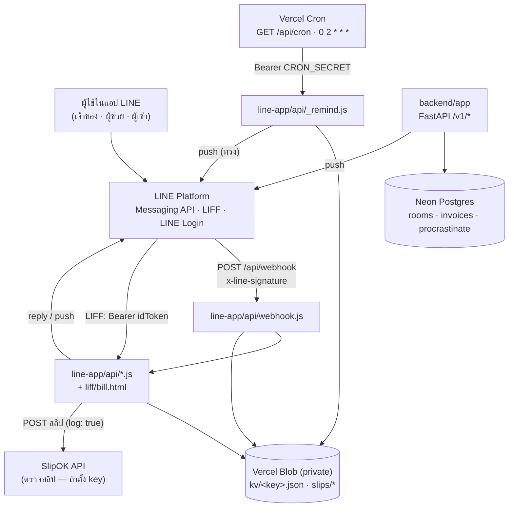

<!-- generated-by: gsd-doc-writer -->

# สถาปัตยกรรมระบบ DormPlus

เอกสารนี้อธิบายสถาปัตยกรรมระดับ repo ของทั้งโปรเจกต์ (ทั้ง `line-app/` และ `backend/`)
ถ้าต้องการรายละเอียดเชิงลึกของครึ่ง LINE app (key map ของ Blob ทุก key, state machine ของบิล,
ตารางสิทธิ์, ลำดับขั้นของ cron) อ่านที่ [`line-app/docs/ARCHITECTURE.md`](../line-app/docs/ARCHITECTURE.md)
— เอกสารนี้จะไม่เขียนซ้ำ

## 1. ภาพรวมระบบ

DormPlus เป็นระบบออกบิลและแจ้งเตือนค่าเช่าหอพัก ที่ผู้ใช้ปลายทางทั้งหมดอยู่ใน LINE:
เจ้าของจดมิเตอร์ → ระบบออกบิล → ผู้เช่าเห็นการ์ดบิลในแชท → แนบสลิป → เจ้าของยืนยัน → ผู้เช่าได้ใบเสร็จ
และถ้ายังไม่จ่าย ระบบทวงให้เองวันละครั้ง

repo นี้มี **สอง stack ที่เป็นอิสระจากกันโดยสมบูรณ์** และตั้งใจให้เป็นแบบนั้น:

| stack | ภาษา/runtime | ที่เก็บสถานะ | ทางเข้า | สถานะ |
|---|---|---|---|---|
| `line-app/` | Node (CommonJS) บน Vercel serverless | Vercel Blob | LINE Messaging API webhook + LIFF + Vercel Cron รายวัน | ใช้งานจริง — เป็นตัวที่ผู้ใช้เห็น |
| `backend/` | Python 3.11+ / FastAPI บน Vercel serverless | Neon Postgres | HTTP `/v1/*` (+ LIFF ของตัวเองที่ `/liff`) | deploy แล้ว ยังไม่มี UI เจ้าของ |

รูปแบบสถาปัตยกรรม: *stateless serverless functions + ที่เก็บสถานะภายนอก* — ทั้งสองฝั่งไม่มี process
ที่รันค้าง ไม่มี middleware กลาง และไม่มี shared code ระหว่างกัน · งานที่เป็น "ประจำ" (ทวงบิลรายวัน)
เกิดจาก Vercel Cron ที่เรียก function ครั้งเดียวแล้วจบ ไม่ใช่ worker

### ทำไมสอง stack ไม่เรียกหากัน

ไม่ได้เป็นเพราะข้อจำกัดทางเทคนิค แต่เป็นเพราะทั้งคู่ถูกสร้างเป็น **implementation คู่ขนานของโดเมนเดียวกัน**
คนละรอบเวลา:

1. **ไม่มีโค้ดฝั่งใดอ้างถึงอีกฝั่งเลย** — grep ในโค้ด/คอนฟิกไม่พบ URL ของ backend ใน `line-app/` (เจอแค่ใน
   เอกสารอย่าง `line-app/HANDOFF.md`) และไม่พบ hostname ของ line-app ใน `backend/` · ไม่มี environment variable ตัวไหนชี้ข้าม stack
   (`line-app/api/*.js` อ่านแค่ env ของ LINE/Blob/ROOMS/CRON/SlipOK · `backend/app/config.py` อ่านแค่
   DB/LINE/cron/session/property)
2. **ไม่มีสัญญาข้อมูลร่วมกัน** — `line-app/` ระบุห้องด้วยรายชื่อใน env `ROOMS`
   (`line-app/api/_rooms.js`, ค่าเริ่มต้น `201`–`212`) ขณะที่ `backend/` เก็บห้องในตาราง `rooms`
   ของ Postgres (`db/schema.sql`) · `line-app/` เก็บบิลเป็นไฟล์ JSON ใต้ `bill:<room>`
   (`line-app/api/_bills.js`) ขณะที่ `backend/` เก็บเป็นแถวใน `invoices`
3. **คนละบทบาทใน lifecycle** — `docs/HANDOFF.md` ระบุชัดว่า `line-app/` คือของที่ผู้ใช้เห็นอยู่ตอนนี้
   ส่วน `backend/` เป็นเป้าหมายระยะยาวตามสัญญา [`docs/API.md`](./API.md)
4. **backend รับ event ได้แล้ว แต่ไม่มีใครส่งมา** — `backend/app/main.py` มี router
   auth · properties · rooms · billing · me · dunning · cron · invites · reports · webhooks
   (`POST /v1/webhooks/line/:property_id` ตรวจ signature → กัน event ซ้ำด้วยตาราง `line_events` →
   เขียน `audit_log`; ถ้าไม่ได้ตั้ง `LINE_CHANNEL_SECRET` ตอบ 503 `LINE_NOT_CONFIGURED`) แต่ **ช่องทางของ OA
   ยังชี้ที่ `line-app/api/webhook.js`** ซึ่งเป็นที่เดียวที่ตอบผู้เช่าจริง
5. **ทางออกของ backend คือ push เท่านั้น** — `backend/app/line_push.py` เรียก
   `POST https://api.line.me/v2/bot/message/push` และไม่รู้จัก state ที่ line-app เขียนไว้

ผลที่ตามมาในทางปฏิบัติ: การแก้บิลใน stack หนึ่งไม่กระทบอีก stack, ไม่มี distributed transaction,
และไม่มี single source of truth ของ "บิลห้อง 203 รอบ 2026-11" — มีสองชุดแยกกันอยู่

<!-- VERIFY: ทั้งสองโปรเจกต์ Vercel (line-app-iota.vercel.app และ line-backend-ten.vercel.app) deploy จาก repo เดียวกันด้วย Root Directory คนละโฟลเดอร์ — ข้อความนี้มาจาก README/docs/HANDOFF ไม่ใช่จากไฟล์ config ในเรพ (vercel.json ไม่มีฟิลด์ root directory) -->
<!-- ตรวจแล้ว 2026-11-16: `vercel crons list` บนโปรเจกต์ line-app คืน `/api/cron  0 2 * * *` (ลงทะเบียนจริง) · `GET /api/cron` ไม่มี header → 401 แปลว่าตั้ง `CRON_SECRET` แล้ว -->

## 2. แผนผังองค์ประกอบ



อ่านแผนผัง: มีสองเส้นทางที่แยกกันโดยสิ้นเชิง — เส้นบน (LINE → `line-app/` → Blob) และเส้นล่าง
(`backend/` → Postgres → push) ทั้งสองเส้นบรรจบกันที่ LINE platform เท่านั้น
ไม่มีลูกศรระหว่าง `line-app/` กับ `backend/` · และ cron รายวันของทั้งระบบอยู่ที่ `line-app/` (เส้นบน)
ไม่ใช่ที่ backend · นอกจาก LINE เอง (`api.line.me` สำหรับ reply/push และตรวจ idToken) แล้ว SlipOK เป็นบริการภายนอกเดียวที่ `line-app/` เรียกออกไป และเป็น *ตัวช่วยตัดสิน* ไม่ใช่
ผู้ออกใบเสร็จ (ปิดบิลยังเป็น postback ของเจ้าของที่ผ่าน `webhook.js`)

## 3. LINE platform คือทางเข้าเดียวของผู้ใช้

ผู้ใช้ไม่มีทางเข้าถึงระบบได้นอกจากผ่าน LINE และมีกลไกของ LINE สามตัวที่ถูกใช้ แต่อยู่คนละฝั่ง:

| กลไก | ใครใช้ | ที่อยู่ในโค้ด |
|---|---|---|
| Messaging API webhook | `line-app/` เท่านั้น (รับ event: follow, ข้อความ `บิล`, postback ยืนยัน) | `line-app/api/webhook.js` |
| LIFF (หน้าเว็บใน LINE) | ทั้งสอง stack — คนละหน้า คนละ LIFF id | `line-app/liff/bill.html` · `backend/liff/index.html` |
| LINE Login (idToken) | ทั้งสอง stack ตรวจ idToken กับ `oauth2/v2.1/verify` | `line-app/api/_auth.js` · `backend/app/line.py` |
| Messaging API push | ทั้งสอง stack (การ์ดบิล · การ์ดยืนยัน · ใบเสร็จ · ทวง · สรุปให้เจ้าของ) | `line-app/api/_line.js` · `backend/app/line_push.py` |

**ฝั่ง `line-app/`** (รายละเอียดเต็มอยู่ใน [`line-app/docs/ARCHITECTURE.md`](../line-app/docs/ARCHITECTURE.md)):

- หน้าเดียว `liff/bill.html` ให้บริการทั้งเจ้าของ ผู้ช่วย และผู้เช่า โดยตัดสินบทบาทจาก `GET /api/me`
  (`line-app/api/me.js` คืน `role: "owner" | "viewer" | null`) — ไม่มีหน้าแยกต่อบทบาท
- webhook ตรวจ `x-line-signature` จาก body ดิบด้วย HMAC-SHA256 (`line-app/api/_line.js`) ก่อนแตะข้อมูลใด ๆ
- การส่งข้อความกลับใช้ `reply()` เมื่อมี replyToken และ `push()` เมื่อต้องหาคนที่ไม่ได้เป็นคนกด
  (`_remind.js` ใช้ `push()` อย่างเดียว เพราะ cron ไม่มี replyToken)
- ข้อความที่ส่งออกมีสี่แบบ (`_line.js`): `billBubble` (การ์ดบิลให้ผู้เช่า), `confirmBubble`
  (การ์ดยืนยันให้เจ้าของ — ถ้าบิลเป็นสลิปใบเดียวหลายรอบ จะเป็นการ์ดเดียวที่ postback ระบุ `periods=`
  ทุกรอบ), `receiptBubble` (ใบเสร็จให้ผู้เช่าหลังยืนยัน) และข้อความ text ของการทวง/แจ้งเตือน
- การ์ด "เพิ่มเพื่อน" — หน้า LIFF เรียก `liff.getFriendship()` ตอน boot (`line-app/liff/bill.html`)
  แล้วแสดงการ์ดชวนเพิ่มเพื่อนเฉพาะเมื่อ `friendFlag === false` ปุ่มในการ์ดเรียก
  `liff.requestFriendship()` · **LINE ไม่อนุญาตให้ app เพิ่มตัวเองเป็นเพื่อน** ผู้ใช้ต้องกดยืนยันใน
  หน้าต่างย่อยที่ LINE เปิดให้เอง · ถ้า `getFriendship()` ตอบไม่ได้ (ไม่ใช่ LIFF browser หรือช่องทาง
  ยังไม่ออกแบบให้ถาม) ค่าเป็น `null` และไม่แสดงการ์ด เพื่อไม่กวนผู้ใช้ด้วยคำเตือนที่อาจไม่จริง

**ฝั่ง `backend/`** ส่งข้อความได้ (`backend/app/line_push.py`, เรียกจาก task ในคิวเท่านั้น —
`backend/app/tasks.py`) และ **รับ event ได้** ที่ `POST /v1/webhooks/line/:property_id` (ตรวจ
`X-Line-Signature` ด้วย `LINE_CHANNEL_SECRET`, กัน event ซ้ำด้วย `webhookEventId` ในตาราง `line_events`,
ตอบ 503 `LINE_NOT_CONFIGURED` ถ้ายังไม่ตั้ง secret) แต่ endpoint นั้นยังไม่มี handler ที่ตอบผู้ใช้ และ
webhook ของ OA ยังชี้ที่ `line-app`

> มี LIFF สองใบที่ห้ามสับสน: `line-app/liff/bill.html` คือใบที่ OA ใช้จริง ส่วน
> `backend/liff/index.html` เป็นหน้าของ stack backend (เรียก `/v1/*` ด้วย cookie) และยังไม่ผูกกับ OA
> — ดูหมายเหตุใน `docs/HANDOFF.md`

## 4. ที่เก็บสถานะ: Blob กับ Postgres

ทั้งสอง stack ใช้ที่เก็บต่างชนิดกันโดยเชิง และไม่มีตัวใดอ่านข้อมูลของอีกตัว

### 4.1 `line-app/` → Vercel Blob แบบ private

ใช้ Blob เป็น key-value store: หนึ่ง key = หนึ่งไฟล์ JSON ใต้พาธ `kv/` และรูปสลิปแยกที่ `slips/`
(`line-app/api/_store.js` — `pathOf()` แปลง key เป็น `kv/${key.replace(/[^a-zA-Z0-9._-]/g,"-")}.json`
คือ `:` กลายเป็น `-` และ path พวกนี้ย้อนกลับไม่ได้)

| ข้อมูล | key | pathname จริง |
|---|---|---|
| ผู้ใช้ผูกห้อง | `user-room:<userId>` | `kv/user-room-<userId>.json` |
| ห้องผูกผู้ใช้ | `room-user:<room>` (ผู้เช่าหลัก — รับการ์ด/ทวง/ใบเสร็จ) + `room-users:<room>` (`[{id, name, at}]` ทุกบัญชีในห้อง รวมคนหลัก) | `kv/room-user-<room>.json` · `kv/room-users-<room>.json` |
| ผู้ใช้ที่เคยกด follow | `user:<userId>` | `kv/user-<userId>.json` |
| บิลล่าสุดของห้อง | `bill:<room>` | `kv/bill-<room>.json` |
| บิลต่อรอบ | `bill:<period>:<room>` + index `bills:<room>` (เก็บ ≤ 60 รอบ) | `kv/bill-<period>-<room>.json` |
| บิลที่ถูกยกเลิก | `bill-void:<period>:<room>:<rev>` + index `bill-voids:<room>` (≤ 200 รายการ) | `kv/bill-void-<period>-<room>-<rev>.json` |
| บิลที่โอนเกินและยังไม่ได้คืน | `overpaid:<room>` (`["<period>:<rev>", …]` ≤ 200 รายการ) | `kv/overpaid-<room>.json` |
| สลิปโอนล่วงหน้า (ยังไม่มีบิล) | `prepay:<room>` | `kv/prepay-<room>.json` |
| เลขอ้างอิงสลิปที่ใช้ไปแล้ว | `slip-ref:<transRef>` | `kv/slip-ref-<transRef>.json` |
| สลิปโอนล่วงหน้าของผู้เช่าเดิม | `prepay-old:<room>` (ใบล่าสุด) · `prepay-old:<room>:<slipAt>` (รายใบ) | `kv/prepay-old-<room>.json` |
| เริ่มสัญญาเช่าปัจจุบันของห้อง | `tenancy:<room>` (`{ since: ISO }`) | `kv/tenancy-<room>.json` |
| มิเตอร์ล่าสุด | `meter:<room>` | `kv/meter-<room>.json` |
| config ต่อห้อง (ทับค่า default) | `room:<room>` (อ่านโดย `configFor()`, เขียนโดย `POST /api/rooms`) | `kv/room-<room>.json` |
| ค่าตั้งของหอ (ชื่อ, ค่าเริ่มต้น, วันครบกำหนด) | `dorm` | `kv/dorm.json` |
| สิทธิ์เจ้าของ/ผู้ช่วย | `owner:<userId>` | `kv/owner-<userId>.json` |
| QR ผูกห้อง | `room-qr:<room>` / `qr-code:<code>` | `kv/room-qr-<room>.json` ฯลฯ |
| ส่งเตือนไปแล้ว | `reminded:<room>:<period>:<kind>:<rev>` (+ key เดิมที่ไม่มี rev ซึ่งยังถูกอ่าน) | `kv/reminded-<room>-<period>-<kind>-<rev>.json` |
| lock ของ cron | `cron-lock` | `kv/cron-lock.json` |
| รูปสลิป | `slips/<room>-<ts>.<ext>` · `slips/<room>-advance-<ts>.<ext>` | pathname เดียวกัน (ไม่อยู่ใต้ `kv/`) |

เอกสารของบิลเอง (`bill:<room>` และ `bill:<period>:<room>`) มีฟิลด์ที่เพิ่มมาหลังจากรอบแรกของระบบ:
`rev` (เริ่ม 1, +1 ทุกครั้งที่ออกใหม่ทับบิลที่ถูกยกเลิก), `issuedAt`, `receiptNo` (เฉพาะบิล `paid`),
`slipGroup { periods, total }`, `prepaid`, `refundDue` และฟิลด์ของการยกเลิก (`voidedAt`, `voidedBy`,
`voidReason`, `statusBefore`)

ฟิลด์เงินที่เพิ่มมาพร้อมสลิป: `slipAmount` (ยอดตามสลิป), `overpaid` (โอนเกิน) และ `shortBy` (โอนขาด)
— ทั้งสามมาจาก `_verify.checkAmount()` และไม่ถูกเขียนเลยถ้าไม่ได้เทียบยอด (ผู้ให้บริการไม่ให้ `amount`)
· `slipRejected { at, by, reason }` เกิดจาก `POST /api/bill` action `reject` (บิลกลับเป็น `unpaid`
โดยสลิปเดิมยังอยู่บนบิลและยังนับในเพดาน 5 ครั้ง) · ฝั่งเงินคืนมี `refundReason: "overpaid"`,
`refundedAt`/`refundedBy`/`refundNote` และ `priorRefund` (ยอดเกินที่คืนไปแล้วก่อนบิลนั้นถูกยกเลิก)

ฟิลด์ `slipVerify` อยู่ทั้งบนบิล (`bill.slipVerify`) และบน `prepay:<room>` (`prepay.slipVerify`) —
เป็นผลจาก `_verify.verifySlip()` รูปแบบ `{ provider:"slipok", ok: true|false|null, reason?, amount?,
transRef?, paidAt?, bank? }` · `ok: null` แปลว่า "บอกไม่ได้" (ไม่ได้ตั้ง key, ผู้ให้บริการล่ม, อ่านสลิปไม่ได้)
ไม่ใช่ "ปลอม" และหน้า LIFF วาดเป็น pill สีเหลือง ไม่ใช่แดง · บิลที่รับสลิปต่อจาก `prepay` เก็บผลตรวจเดิมไว้
แต่ **ตรวจยอดใหม่กับยอดของบิลที่เพิ่งออก** (`prepaidCopy()` → `checkAmount()`) เพราะตอนสลิปมาถึงยังไม่มีบิลให้เทียบ
· ผลตรวจของสลิปที่รอเป็น `prepay` ถูกเก็บไว้และ **แสดงในหน้าห้องแล้ว** (`GET /api/rooms` ส่ง `advance.verify` มาให้ LIFF วาด pill) — เจ้าของเห็นผลตรวจก่อนออกบิล

**เลขใบเสร็จไม่ใช้ counter** — `receiptNoOf()` ใน `_bills.js` คำนวณจากตัวบิลเอง:
`R<yyyymm>-<room>` และต่อท้าย `-<rev>` ตั้งแต่รอบที่ออกใหม่ครั้งที่สอง เพราะ Blob ไม่มี transaction
ถ้าใช้ counter กลาง เลขเดียวกันจะถูกแจกสองใบได้

ทุกการอ่านระบุ `useCache: false` และทุกการเขียนเป็น `allowOverwrite: true` — ไม่มี transaction,
ไม่มี conditional write, ไม่มี compare-and-set ดังนั้นรูปแบบ "อ่าน–แก้–เขียน" จึงเป็น race ได้
มีสองที่ที่ออกแบบรับข้อจำกัดนี้ไว้แล้วโดยตรง: `cron-lock` (บรรเทา overlap ของ cron) และการล้าง
`prepay:<room>` ที่จะล้างเฉพาะเมื่อ `slipAt` ยังตรงกับใบที่เพิ่งใช้ไป (ดู §5.1) — ดูข้อจำกัดใน
[`line-app/docs/ARCHITECTURE.md`](../line-app/docs/ARCHITECTURE.md)

ชั้นที่สามคือ **idempotency ของ push**: ทุก `push()` ที่อาจเกิดจากสอง request พร้อมกันแนบ
`X-Line-Retry-Key` ที่คำนวณจากเนื้อข้อความ (`retryKeyOf()` ใน `_line.js` hash เป็น UUID) — `receipt:`
(ใบเสร็จ), `confirm:` (`confirmKey()` ใน `_bills.js` — การ์ดยืนยันของเจ้าของ), `remind:` และ
`remind-summary:` — และถ้า LINE ตอบ 409 ถือว่า "ส่งไปแล้ว" (`{ duplicate: true }`) ไม่ใช่ error
ผู้เช่าจึงได้ใบเสร็จใบเดียวแม้เจ้าของสองคนกดยืนยันพร้อมกัน · ข้อนี้กัน *ข้อความ* ซ้ำเท่านั้น
ไม่ได้กันการเขียนทับข้อมูล — Blob ยังไม่มี compare-and-set

<!-- VERIFY: Blob store ถูกผูกกับโปรเจกต์ Vercel ผ่าน OIDC (ไม่มีการใส่ token ในโค้ด) และชื่อ store/env มาจากการตั้งค่าบน Vercel ไม่ใช่จากไฟล์ในเรพ — โค้ดเรียก @vercel/blob โดยไม่ระบุ token -->

### 4.2 `backend/` → Neon Postgres

schema อยู่ที่ `db/schema.sql` (snapshot อ่านอย่างเดียว) แต่ **ตัวที่รันจริงคือ Alembic migration**
ใน `backend/migrations/versions/` (`0001_initial_schema.py`, `0002_link_codes.py`,
`0003_auth_failures.py`, `0004_rls_property.py`, `0005_line_events.py`)

| กลุ่มตาราง | ตาราง | ใช้ทำอะไร |
|---|---|---|
| โดเมนหอพัก | `properties`, `rooms`, `tenants` | หอ/ห้อง/ผู้เช่า · `tenants.line_user_id` คือจุดผูก LINE |
| มิเตอร์และบิล | `readings`, `invoices`, `invoice_items` | `UNIQUE(room_id, period)` กันบิลซ้ำที่ระดับ DB |
| การชำระเงิน | `payments` | `verify_ok` เป็น `null` = ยังไม่มีใครตรวจ (manual) |
| การสื่อสาร | `message_log` | ใช้กันส่งทวงซ้ำ: นับเฉพาะแถวที่ `line_status = 'ok'` |
| ความปลอดภัย | `link_codes`, `auth_failures`, `audit_log`, `line_events` | รหัสเชิญ (เก็บเฉพาะ SHA-256), rate limit การเดารหัส, audit trail, และ `webhookEventId` ของ LINE ที่เคยรับแล้ว (กัน redelivery) |
| คิว | ตารางของ Procrastinate (สร้างโดย `python -m app.queue`) | job queue ฝังใน Postgres ตัวเดียวกับโดเมน |

RLS ทำงานจริงตั้งแต่ migration `0004`:

- `backend/app/db.py` → `attach_property()` ผูก `app.property_id` ให้ทุก connection ตอน `connect`
  (`select set_config('app.property_id', ..., false)`) ด้วยค่า `PROPERTY_ID` ของ deployment
  (หนึ่ง deployment = หนึ่งหอ, `backend/app/config.py`)
- policy ของแต่ละตารางเทียบ `property_id` กับ `current_setting('app.property_id', true)` และถูก
  `force row level security` เพราะ app ต่อด้วย user ที่เป็นเจ้าของตาราง (เจ้าของข้าม policy ได้ถ้าไม่ force)
- policy มีผลทั้งอ่านและเขียน (`for all ... using (...) with check (...)`): เขียนแถวของหออื่นถูกปฏิเสธ
- ถ้า setting ว่าง/NULL predicate จะเป็น NULL = **ไม่เห็นแถวไหนเลย** (fail closed) ไม่ใช่เห็นทั้งหมด
- ตารางลูก (`tenants`, `readings`, `invoices`, `invoice_items`, `payments`, `message_log`) ไม่มีคอลัมน์
  `property_id` จึงเดินขึ้นไปที่ `rooms` ผ่าน FK ใน policy · `message_log` แถวที่ `invoice_id is null`
  (ข้อความกลาง ๆ ไม่ผูกบิล) ถูกเก็บไว้ · `auth_failures` ไม่มี RLS (ผูกกับบัญชี LINE ไม่ใช่หอ)
- `line_events` (migration `0005`) ถือ `property_id` ของตัวเองและมี policy แบบ `force` เหมือน `0004`
  (setting ว่าง = ไม่เห็นแถว) · `event_id` เป็น primary key เดียวทั้งระบบ ไม่ได้แยกตามหอ · grant ให้
  `dormplus_app` ถูกทำแบบมีเงื่อนไข (`if exists (select 1 from pg_roles …)`) เพื่อให้ DB ใหม่ใน CI
  ที่ยังไม่มี role นั้นยัง migrate ผ่าน
- **role ของ app ต้องไม่มี `BYPASSRLS`** — `neondb_owner` ของ Neon เป็นเจ้าของและ bypass policy
  (เช็คได้ด้วย `select rolbypassrls from pg_roles where rolname = current_user`) ส่วน role ที่แนะนำ
  สำหรับ production คือ `dormplus_app` (DML + sequences, ไม่มี BYPASSRLS) · alembic ยังรันด้วย owner
- เทสต์ `backend/tests/test_rls.py` ตรวจ policy ผ่าน role อื่นที่ไม่ใช่ owner/superuser
  (CI ต่อเป็น `postgres` ซึ่งเป็น superuser และ bypass RLS เสมอ จึงต้อง `set local role`)

การกรองในโค้ดยังอยู่ครบ — RLS เป็นชั้นกันพลาด ไม่ได้แทนที่ `where property_id = ...`

<!-- VERIFY: ฐานข้อมูลจริงคือ Neon Postgres ที่สร้างผ่าน Vercel Marketplace และ production ใช้ role dormplus_app จริง — ข้อความนี้มาจาก backend/README.md และ docs/HANDOFF.md ไม่สามารถยืนยันได้จากเรพ (connection string อยู่ใน backend/.env ที่ไม่ถูก commit) -->

## 5. งานประจำวัน: cron ของ line-app และคิวของ backend

### 5.1 `line-app/` — cron รายวัน (เจ้าของงานทวงแต่ผู้เดียว)

`line-app/vercel.json` ประกาศ `{ "path": "/api/cron", "schedule": "0 2 * * *" }` (02:00 UTC = 09:00 น.
เวลาไทย) และ `line-app/api/cron.js` เป็นทางเข้าของงานนี้:

1. รับ `GET` เท่านั้น (อื่น ๆ = 405) · อ่าน `CRON_SECRET` จาก env; ถ้ายาวไม่ถึง 16 ตัวตอบ 503
   `NOT_CONFIGURED` (ไม่ถือว่าตั้งค่าแล้ว) · เทียบ token ใน `Authorization: Bearer` ด้วย
   `sameSecret()` (`crypto.timingSafeEqual`) ไม่ผ่าน = 401
2. คำนวณ "วันนี้" ตามเวลาไทยด้วย `Intl.DateTimeFormat(..., { timeZone: "Asia/Bangkok" })`
   ไม่ใช่วัน UTC ของ server
3. อ่าน `cron-lock`; ถ้ามี lock ที่อายุน้อยกว่า 15 นาที ตอบ 200 `{ skipped }` แล้วจบ
   (Vercel อาจ retry run ที่ timeout ขณะ run แรกยังทำงาน — Blob ไม่มี compare-and-set จึงทำได้แค่
   บรรเทา ไม่ได้กันได้ 100%) · เขียน lock แล้วลบใน `finally`
4. `_remind.runReminders({ today, baseUrl })` แล้วตอบ `{ ok, today, sent, failed }`

`line-app/api/_remind.js` เป็นที่ที่กฎการทวงอยู่ (ไม่ผูกกับ HTTP จึงเทสต์ด้วยวันที่ใดก็ได้):

- ต่อห้อง (ทำพร้อมกัน 4 ห้องด้วย `mapLimit`): อ่าน `bill:<room>` + `bills:<room>` แล้วอ่านบิลเก่า
  เพิ่มไม่เกิน 12 รอบ ผ่าน `_ledger.recentBills()` — หน้าต่างเดียวกันกับที่ `GET /api/bill?overdue=1`
  ใช้ แล้วกรองเหลือเฉพาะที่ยัง `unpaid` และมี `due`
- เทียบ `due` กับ `today` เป็น *หน้าต่าง* ไม่ใช่วันเป๊ะ — พลาด cron ไปหนึ่งวัน ข้อความยังออกในวันถัดไป:

  | เงื่อนไข | kind |
  |---|---|
  | เหลือ 1–3 วัน | `before_3` |
  | ครบกำหนดวันนี้ | `due_0` |
  | เลย 1 วันขึ้นไป | `after_1` |
  | เลย 5 วันขึ้นไป | `after_5` |
  | เลย 10 วันขึ้นไป | `after_10` |

- กันส่งซ้ำด้วย mark `reminded:<room>:<period>:<kind>:<rev>` — **มี `rev`** เพราะบิลที่ถูกยกเลิกแล้ว
  ออกใหม่ (อาจได้ due ใหม่) ต้องทวงได้อีกครั้ง · key เดิมที่ไม่มี `rev` ยังถูกอ่านเป็น fallback
  เพื่อไม่ให้ deploy รอบแรกยิงทุกอย่างซ้ำ
- ส่งให้ผู้เช่าที่ผูกอยู่ (`room-user:<room>`) และเฉพาะบิลที่ผ่าน `visibleToTenant()` (บิลของผู้เช่าคนก่อน
  ไม่ถูกทวงหาคนปัจจุบัน) · หนึ่ง push ต่อห้อง สูงสุด 5 การ์ดต่อ push
- **at-least-once:** เขียน mark หลัง push สำเร็จเท่านั้น · push ล้ม = ไม่ mark แล้วลองใหม่พรุ่งนี้ ·
  เขียน mark ล้ม = พรุ่งนี้อาจได้ข้อความซ้ำหนึ่งครั้ง (เลือกทางนี้เพราะการไม่ทวงเลยแย่กว่า)
- **กัน run ที่สองของวันเดียวกันด้วย retry key:** push แต่ละชุดพา `X-Line-Retry-Key` ที่ระบุ
  `remind:<room>:<today>:<period>:<kind>:<rev>:<total>:<due>,…` (และ `remind-summary:<today>:<text>`)
  run ที่สองจึงคำนวณ key เดิม → LINE ตอบ 409 → นับเป็น `duplicate` ไม่ใช่ `sent` และไม่ทำให้ยอดสรุปของเจ้าของพอง
  · key มี `total`/`due` อยู่ด้วย บิลที่ออกใหม่ด้วย `rev` เดิมแต่ยอดหรือวันเปลี่ยนจึงเป็นข้อความใหม่ ไม่ถูกทิ้ง
- ปิดท้าย: ถ้ามีห้องที่ `after_*` ส่งสรุปหนึ่งข้อความให้ `OWNER_USER_ID`

### 5.2 `backend/` — คิว Procrastinate (ยังอยู่ แต่ไม่มี schedule แล้ว)

backend ใช้ **Procrastinate** เป็นคิวที่เก็บใน Postgres ตัวเดียวกับข้อมูลโดเมน ไม่มี broker แยก:

- `backend/app/queue.py` — สร้าง `procrastinate.App` สองตัว: `app` (sync connector, ใช้ตอน enqueue)
  และ `async_app` (async connector, ใช้ตอน drain เพราะ `run_worker` ต้องมี event loop)
  · `apply_schema()` สร้างตารางของ Procrastinate
- `backend/app/tasks.py` — task เดียวที่คุยกับ LINE: `line.push_text` (`retry=3`) เขียนทุกความพยายามลง
  `message_log` และ raise `PushFailed` เมื่อ LINE ไม่รับ เพื่อให้คิว retry
- `backend/app/dunning.py` — `due_for_reminder()` เลือกบิล `unpaid` ที่เลยกำหนด 1 / 5 / 10 วัน
- `backend/app/routes/cron.py` — `GET /v1/cron/daily`: ตรวจ `Authorization: Bearer <CRON_SECRET>`
  ด้วย `hmac.compare_digest` → `due_for_reminder()` → `queue_reminders()` → `drain_queue()` → ตอบ
  `{queued, drained}` · endpoint นี้ยังอยู่ใน `backend/app/main.py`

**แต่ `backend/vercel.json` ไม่มีบล็อก `crons` แล้ว** — cron รายวันของทั้งระบบย้ายไปที่ `line-app/`
เพื่อให้การทวงมีเจ้าของเดียว (ไม่ทวงซ้ำจากสอง stack ด้วยข้อความคนละชุด) · ผลคือ `GET /v1/cron/daily`
ยังเรียกได้ด้วยมือ/จาก scheduler ภายนอกถ้าเอาความสามารถนั้นกลับมา แต่ไม่มีอะไรเรียกเองแล้ว

จุดสำคัญทางสถาปัตยกรรม (ยังจริงถ้าเปิดใช้): **enqueue และ drain เกิดใน invocation เดียวกัน** —
`drain_queue()` เรียก `run_worker_async(wait=False, concurrency=4, listen_notify=False)` แล้วจบเมื่อคิวว่าง
จึงไม่ต้องมี host สำหรับ worker · งานที่ยังไม่ถูกหยิบเมื่อ function ถูกตัดจะยังอยู่ในตารางและถูกหยิบ
ในรอบถัดไป (at-least-once) ซึ่งเป็นเหตุผลที่ task ต้อง idempotent

ทางเลือกที่ยังเปิดอยู่: รัน `procrastinate -a app.queue.app worker` เป็น process ค้างบน Fly/Railway/VM
ชี้ Postgres ตัวเดียวกัน (ระบุไว้ใน docstring ของ `backend/app/queue.py`)

`POST /v1/dunning/run` (`backend/app/routes/dunning.py`) ยังอยู่สำหรับสั่ง enqueue อย่างเดียวด้วยมือ
และ **ปฏิเสธ token ที่มาใน query string** โดยตั้งใจ (URL หลุดเข้า access log)

<!-- VERIFY: Vercel Hobby รัน cron ได้วันละครั้ง คลาดได้ถึง ±59 นาที, function มีเพดาน 300 วินาที และ deployment หนึ่งมีไม่เกิน 12 serverless function — เป็นข้อจำกัดของแพลตฟอร์ม ไม่ได้ประกาศในเรพ (อ้างจากคอมเมนต์ใน line-app/api/qr.js, line-app/api/cron.js, backend/app/routes/cron.py และ backend/README.md) -->

## 6. เส้นทาง request ที่มีจริง

### 6.1 ออกบิล → Flex card → LIFF แนบสลิป → เจ้าของยืนยัน → ใบเสร็จ (`line-app/`)

1. เจ้าของเปิด LIFF → `GET /api/rooms` (`line-app/api/rooms.js`) ได้ทุกห้อง + config + meter + bill +
   `linked` (มีผู้เช่าผูกหรือไม่) + `advance` (สลิปที่แจ้งโอนมาก่อนบิลจะออก)
2. กรอกหน่วยน้ำ/ไฟ แล้วกดออกบิล → `POST /api/run` (`line-app/api/run.js`)
   - ตรวจ `requireUser` → `isOwner` → `readings` ไม่ว่าง → `period` ตรง `^\d{4}-(0[1-9]|1[0-2])$`
   - ต่อห้อง (ทำพร้อมกัน 6 ห้อง): `configFor(room)` → คูณหน่วยเป็นบาท (`Math.round`) → เขียน
     `meter:<room>` และ `saveBill()` (เขียนทั้ง `bill:<period>:<room>`, index และ `bill:<room>`)
   - บิลที่ `pending`/`paid` อยู่แล้วถูกข้าม ไม่ถูกรีเซ็ตเป็น `unpaid` · บิล `unpaid` ออกใหม่ได้
     (แก้พิมพ์ผิด) ด้วย `rev` เดิม · บิล `void` ออกใหม่ได้ด้วย `rev + 1`
   - ถ้ามี `prepay:<room>` ของผู้เช่าคนนี้ และรอบที่ออกใหม่คือรอบล่าสุด บิลจะเริ่มเป็น `pending`
     พร้อม `slipPath`/`slipAt`/`slipCount` และ `prepaid: true` แล้วเจ้าของได้การ์ดยืนยันทันที
   - ถ้ามี `room-user:<room>` ก็ `push()` การ์ด `billBubble()`
3. การ์ดบิลในการ์ด LINE มีปุ่มเปิด LIFF ของบิลนั้น (`_line.billBubble(bill, baseUrl)`)
4. ผู้เช่าแนบสลิป → `POST /api/slip` (`line-app/api/slip.js`): ตรวจสิทธิ์รายห้อง → บิล `paid`/`void`
   ถือว่า "ยังไม่มีบิลให้จ่าย" → **สลิปใหม่ของผู้เช่าต้องมีรูป** (400 `ต้องแนบรูปสลิป`) — ข้อยกเว้นเดียว
   คือแก้แค่หมายเหตุของสลิปที่ส่งไปแล้ว (บิล `pending` ที่มีรูปอยู่ หรือ `prepay` ที่มีรูป) และสลิปหลายรอบ
   ไม่มีข้อยกเว้น เพราะจะแยกบิลออกจากกลุ่มที่ผลตรวจยังอธิบายยอดรวมอยู่ · เจ้าของบันทึกได้โดยไม่ต้องมีรูป
   (เงินสด / โอนที่เห็นในแอปธนาคาร) → **เฉพาะผู้เช่า** จำกัด 5 ครั้ง/บิล ห่าง ≥ 30 วินาที (เจ้าของไม่ติดเพดานนี้)
   → อัปโหลดรูป (≤ 3MB, JPEG/PNG/WEBP) ไป `slips/<room>-<ts>.<ext>` → ตรวจสลิป (ข้อย่อยถัดไป) →
   `saveBills({...bill, status:"pending", slipPath, slipAt, slipCount, slipVerify})` →
   `push()` การ์ด `confirmBubble()` หาเจ้าของ · คำตอบมี `verify` กลับไปให้หน้าเว็บวาด pill
   - **การตรวจสลิป (`api/_verify.js`):** `verifySlip({ bytes, mime, amount })` ยิง
     `POST https://api.slipok.com/api/line/apikey/<SLIPOK_BRANCH_ID>` พร้อม header `x-authorization`
     = `SLIPOK_API_KEY`, timeout 10 วินาที และส่ง `log: true` **ตลอด** — ถ้าไม่ส่ง `log` SlipOK แค่อ่านสลิป
     ไม่เทียบบัญชีผู้รับของ branch และไม่จำสลิปไว้กันใช้ซ้ำ การไม่ตั้ง key/branch ตัวใดตัวหนึ่ง =
     `ok: null, reason: "not_configured"` และการแนบสลิปยังทำงานเหมือนเดิม
   - **ผลตรวจไม่ได้ปิดบิล** — บิลยังเป็น `pending` จนเจ้าของกดยืนยันในข้อ 5 · `ok: true` คือหลักฐาน
     (`amount`, `transRef`, `paidAt`, `bank`), `ok: false` คือ 1012 สลิปซ้ำ / 1013 ยอดไม่ตรง / 1014
     บัญชีผู้รับไม่ใช่ของหอ, และ `ok: null` คือ 1006/1007/1009/1010/1011 (อ่านรูปไม่ได้, ไม่มี QR, ธนาคารขัดข้อง,
     สลิปใหม่เกินไป, QR หมดอายุ) รวมถึงผู้ให้บริการล่ม — "ตรวจไม่ได้" ไม่ถูกแสดงเป็น "ปลอม"
   - **กันสลิปซ้ำด้วย key ของเราเอง:** `rememberRef()` เขียน `slip-ref:<transRef>` ก่อนบันทึกบิล ถ้า
     `transRef` นั้นเคยถูกใช้แล้วจะตอบ `ok: false` พร้อมบอกห้องที่ใช้ไป — เป็นชั้นที่สองถัดจากที่ SlipOK
     จำสลิป (ซึ่งจำได้เฉพาะเท่าที่ branch เก็บไว้) · เขียน ref ก่อนบิลจึงปิดช่องจ่ายสองบิลด้วยสลิปใบเดียว
     ได้ แต่ถ้าเขียนบิลล้มหลังเขียน ref สลิปนั้นจะถูกมองว่าซ้ำ (แลกมาด้วยการกันการจ่ายซ้ำ)
   - **เทียบยอด (`checkAmount`):** ผลตรวจ + ยอดบิล → `{ verify, slipAmount, overpaid, shortBy }` แล้วเขียน
     `slipAmount`/`overpaid`/`shortBy` ลงบิล (และ `slipGroup` ของสลิปหลายรอบ) ผ่าน `withAmounts()` ·
     ยอดไม่เท่า = `ok: false` พร้อมเหตุผลภาษาไทย "เกินบิล X บาท" / "ขาด X บาท" **ไม่บล็อก** เจ้าของยังตัดสินเอง
     · โอนเกิน **คืนเป็นเงิน ไม่ทบเป็นเครดิตบิลรอบถัดไป** (ดูข้อ 5) · ถ้าผู้ให้บริการไม่ให้ `amount`
     ทั้งสามฟิลด์ไม่ถูกเขียนเลย เพราะไม่ได้เทียบอะไร
   - **สลิปเก่า / โอนก่อนบิล (`markStale` / `markEarly` ใน `_verify.js`):** เรียกหลัง `rememberRef` เสมอ
     (transRef ยังถูกจำไว้กันใช้ซ้ำ) · `markStale` = โอนนานกว่า 30 วัน, `markEarly` = `paidAt` ก่อน
     `bill.issuedAt` ทั้งคู่ **ลด `ok: true` เป็น `ok: null`** พร้อมเหตุผลภาษาไทย (`stale`, `staleDays`,
     `early`) เพื่อให้เจ้าของอ่านวันที่ก่อนกดยืนยัน — **ไม่เคยบล็อก** การแนบสลิป และไม่แตะ `slip-ref` ·
     สลิปโอนล่วงหน้า (`prepay`) ข้าม `markEarly` เพราะเกิดก่อนบิลโดยธรรมชาติ
   - **สลิปมาก่อนบิล:** ถ้าไม่มีบิลเลย หรือบิลล่าสุด `paid`/`void` สลิปจะถูกเก็บเป็น `prepay:<room>`
     (รูปอยู่ที่ `slips/<room>-advance-<ts>.<ext>`) พร้อม `slipVerify` แล้ว push ข้อความบอกเจ้าของ · `POST /api/run`
     รอบถัดไปจะผูกให้เอง (และล้าง `prepay` เฉพาะเมื่อ `slipAt` ยังตรงกับใบที่ใช้ไป)
   - **สลิปใบเดียวหลายรอบ:** `periods: ["2026-10","2026-11"]` (1–12 รอบ, ไม่ซ้ำ, ทุกรอบต้อง
     `unpaid`/`pending`) → ทุกรอบเป็น `pending` ด้วย `slipPath`/`slipAt` เดียวกัน + `slipGroup:
     { periods, total }` และเจ้าของได้ **การ์ดเดียว** ที่ postback ระบุ `periods=` ทุกใบ ·
     การตรวจสลิปใช้ `amount` = ผลรวมทุกรอบ (โอนครั้งเดียวหลายเดือนจะไม่ผ่าน 1013 ถ้ายอดไม่ครบ)
5. เจ้าของกด "ยืนยันการชำระ" → postback `action=confirm&room=…&period=…` (หรือ `periods=…` สำหรับกลุ่ม)
   → `POST /api/webhook` → `webhook.js` ตรวจ `x-line-signature` → `isOwner(userId)` →
   - ใบเดียว: บิลต้องเป็น `pending` → `paidCopy()` เขียน `status:"paid"`, `paidAt`, `confirmedBy`,
     `receiptNo = receiptNoOf(bill)` · ถ้ามียอดโอนเกิน บิลได้ `refundDue` (ยอดเกิน) + `refundReason:"overpaid"`
     และถูก tag ลง `overpaid:<room>` ผ่าน `tagOverpaid()` — **คืนเป็นเงิน ไม่ทบเป็นเครดิตบิลรอบถัดไป**
     (สลิปหลายรอบเป็นโอนครั้งเดียว ยอดเกินจึงตกที่รอบใหม่สุดรอบเดียว: `overpaidOf()` ใน `_bills.js`)
   - กลุ่ม: ปิดเฉพาะรอบที่ยัง `pending` **และ** `slipGroup.periods` ตรงกับ key ของการ์ด ·
     รอบที่ไปต่อแล้วถูกข้ามและบอกในคำตอบ · คำตอบระบุ "ยอดที่ปิด" จริง (ผลรวมอาจต่างจากบนการ์ด
     ถ้ามีรอบถูกยกเลิกไปแล้ว)
   → `push()` ใบเสร็จ (`receiptBubble`) ให้ผู้เช่า (แบ่งชุดละ ≤ 5 · `X-Line-Retry-Key` =
   `receipt:<room>:<tenant>:<period>:<rev>:<total>:<receiptNo>:<slipAt>,…` ลายเซ็นของใบเสร็จใบนั้น
   จึงมีใบเดียวแม้เจ้าของสองคนกดพร้อมกัน) และ `reply()` ยืนยันให้เจ้าของ (ต่อท้ายด้วย
   "ยอดเกิน X บาท — ต้องคืนผู้เช่า" ถ้ามี)
6. ดูรูปสลิป: `GET /api/slip-image?room=` → ตรวจสิทธิ์ → `getFile()` แบบ private → stream กลับ ·
   `&advance=1` อ่าน `prepay:<room>` · `&archived=1` อ่าน `prepay-old:<room>` (เฉพาะ staff)
7. ดูใบเสร็จ: การ์ดใบเสร็จพาไป LIFF ด้วย `?room=…&receipt=<period>#receipt/<period>` (LIFF อาจทิ้ง
   fragment ตอน login หน้าเว็บจึงสร้าง route ใหม่จาก query) แล้ววาดใบเสร็จจากข้อมูลบิลที่โหลดมาอยู่แล้ว
   (`GET /api/bill`) · บิล `paid` ที่ยังไม่มี `receiptNo` จะถูกคำนวณให้ตอนอ่าน

บิลที่ยังจ่ายได้ (`unpaid`/`pending`) มาพร้อม `pay = { payload, qr }` จาก `_promptpay.payloadFor()`
(EMVCo PromptPay payload ของหอ อ่านจาก `dorm.promptpay`) และ `_qr.qrSvg()` — สร้าง SVG เองเพราะหน้า LIFF
ไม่มีไลบรารี QR · ยังไม่ตั้ง PromptPay ของหอ = `pay: null`

<!-- VERIFY: production ตั้ง SLIPOK_API_KEY/SLIPOK_BRANCH_ID บน Vercel จริง และ branch ผูกบัญชีรับเงินของหอไว้แล้ว — ไม่มีค่าใดในเรพที่ยืนยันได้ (env อยู่ใน Vercel dashboard) และถ้า branch ผูกบัญชีอื่น สลิปที่โอนเข้าบัญชีอื่นจะไม่ถูกจับด้วย 1014 -->

bil object ถูกเขียนทับทั้งก้อนทุกครั้ง (ไม่มี event log) — state machine เต็มอยู่ใน
[`line-app/docs/ARCHITECTURE.md`](../line-app/docs/ARCHITECTURE.md)

### 6.2 ยกเลิกบิล → archive → ออกใหม่ (`line-app/`)

บิล `paid` ไม่ถูกแก้ในที่ — ทางเดียวคือยกเลิกแล้วออกใหม่:

1. เจ้าของกดยกเลิก → `POST /api/bill` body `{ action: "void", room, period, reason }`
   (`line-app/api/bill.js`) — ต้องเป็น owner, `room` ต้องอยู่ใน `ROOMS`, `reason` 1–200 ตัวอักษร,
   บิลต้องไม่ใช่ `void` อยู่แล้ว (409 `INVALID_STATE`)
2. เขียนบิลเป็น `status:"void"` พร้อม `voidedAt`, `voidedBy`, `voidReason`, `statusBefore` และเก็บ
   `receiptNo`/`slipPath` เดิมไว้ (ใบเสร็จที่ออกไปแล้วคือหลักฐาน) · ถ้าบิลเดิม `paid` จะใส่
   `refundDue` — ระบบไม่เคลื่อนเงินเอง ตัวเลขนี้คือยอดที่เจ้าของต้องคืน · บิลที่เคยมี **ยอดโอนเกิน** ค้างอยู่
   จะได้ `refundDue = total + ยอดเกินที่ยังไม่ได้คืน` และยอดเกินที่คืนไปก่อนแล้วถูกเก็บเป็น `priorRefund`
   (ไม่คัดลอก `refundedAt` เดิมมาทับ ไม่ให้ยอดค้างหายจากรายการ)
3. **archive ทันทีที่ตอนยกเลิก** ไปที่ `bill-void:<period>:<room>:<rev>` และเพิ่ม `<period>:<rev>`
   ใน `bill-voids:<room>` (idempotent, `run.js` archive ซ้ำได้) — บิลที่ยกเลิกแล้วไม่ออกใหม่ก็ยังอ่านได้
   ผ่าน `GET /api/bill?room=&voided=1` (เจ้าของ/ผู้ช่วยเท่านั้น, ใหม่→เก่า, กรอง `period=` ได้)
   · `voided=1&refunds=1` เปลี่ยนความหมายเป็น "เงินที่ยังต้องคืน" (ดู §6.7)
4. แจ้งผู้เช่าที่ผูกอยู่ (ถ้าบิลนั้นยังผ่าน `visibleToTenant`)
5. ออกใหม่ด้วย `POST /api/run` รอบเดิม → `rev + 1` → `receiptNo` ใหม่ (`R202611-203-2`) ส่วนใบเก่า
   ยังอยู่ใน archive · บิล `void` ไม่ถูกนับเป็นการทวง และสลิปใหม่จะไปรอเป็น `prepay:<room>`

`POST /api/bill` มีอีกสอง action ที่ไม่ใช่การยกเลิก (`action` อื่นตอบ 400):

- **`reject`** — เจ้าของตีกลับสลิป `{ action:"reject", room, period, reason }`: บิลต้องเป็น `pending`
  เท่านั้น (ไม่งั้น 409 `INVALID_STATE`) → เขียน `status:"unpaid"` + `slipRejected { at, by, reason }`
  โดย **ไม่ลบ** `slipPath`/`slipVerify`/`slipCount` (สลิปเดิมคือหลักฐาน และยังนับในเพดาน 5 ครั้ง)
  → push บอกผู้เช่าให้แนบใหม่ · บิลที่ถูกตีกลับจึงพร้อมรับสลิปใบใหม่ทันที
- **`refunded`** — เจ้าของยืนยันว่าคืนเงินแล้ว `{ action:"refunded", kind?, room, period, rev, note? }`
  โดย `kind` เป็น `"void"` (ค่าเริ่มต้น) หรือ `"overpaid"` · `void` อัปเดต archive
  `bill-void:<period>:<room>:<rev>` และบิลปัจจุบันถ้ายังเป็น rev เดียวกัน · `overpaid` ประทับบนบิล `paid`
  ของ rev นั้น · ผิด rev / ไม่มียอดค้าง / คืนไปแล้ว = 409 · ระบบไม่เคลื่อนเงินเอง — action นี้ปิด to-do
  ที่ `refundDue` เปิดไว้เท่านั้น

### 6.3 ทวงอัตโนมัติรายวัน (`line-app/`)

Vercel Cron → `GET /api/cron` (`Authorization: Bearer <CRON_SECRET>`) → `_remind.runReminders()`
→ วน `ROOMS` (4 ห้องพร้อมกัน) → อ่านบิลค้าง → เลือกหน้าต่าง (`before_3`/`due_0`/`after_1`/`after_5`/
`after_10`) → ตรวจ mark `reminded:<room>:<period>:<kind>:<rev>` → ตรวจผู้เช่าปัจจุบันและ tenancy →
`push()` สูงสุด 5 การ์ดต่อห้อง → เขียน mark → สรุปให้เจ้าของถ้ามีห้องเลยกำหนด · รายละเอียดใน §5.1

### 6.4 ผูกผู้เช่า → session cookie → อ่านเฉพาะห้องตัวเอง (`backend/`)

1. เจ้าของสร้างรหัสเชิญ → `POST /v1/rooms/{room_id}/invite` (`backend/app/routes/invites.py`)
   - รหัส 8 ตัวจาก alphabet ที่ไม่มีตัวคล้ายกัน (`backend/app/invites.py`), เก็บเฉพาะ `sha256`
   - TTL 7 วัน, ใช้ได้ครั้งเดียว, ออกรหัสใหม่จะ revoke รหัสเก่าที่ยังไม่ใช้ของ tenant คนนั้น
   - คืน `link_url = https://liff.line.me/{LIFF_ID}?code=…` (เป็น `null` ถ้าไม่ได้ตั้ง `LIFF_ID`)
2. ผู้เช่าสแกน QR → เปิด LIFF → `liff.getIDToken()` → หน้าเว็บเรียก `POST /v1/auth/line/link`
   (`backend/liff/index.html` → `backend/app/routes/auth.py` `link_with_line`)
   - ตรวจ `attempts.ensure_not_blocked()` (ผิดได้ 10 ครั้ง/ชม./บัญชี LINE, `backend/app/attempts.py`)
   - `verified_line_user()` → `line.verify_id_token(id_token, LINE_CHANNEL_ID)` (ตรวจ `aud` ด้วย)
   - ใน transaction เดียว: `select … from link_codes where code_hash = :hash for update` →
     ตรวจ `used_at` / `revoked_at` / `expires_at` → ผูก `tenants.line_user_id` (หรือเพิ่ม tenant ใหม่
     กรณีรูมเมท) → mark code used → `insert into audit_log`
3. `start_tenant_session()` เซ็น cookie `dp_session` ด้วย `SESSION_SECRET`
   (`backend/app/session.py`: HMAC-SHA256, `exp` 7 วัน, HttpOnly, SameSite=Lax, `secure` ตาม `COOKIE_SECURE`)
4. ทุก request ถัดไป: `current_session()` (`backend/app/auth.py`) อ่าน cookie → `unsign()` →
   ถ้า `role == "tenant"` เรียก `still_linked()` ตรวจกับ DB ทุกครั้ง (join `tenants` × `rooms` +
   `moved_out is null or > current_date`) — ถ้าถูกถอด LINE หรือย้ายออก ตอบ 401 `SESSION_REVOKED` ทันที
5. อ่านข้อมูล: `GET /v1/me/invoices` ใช้ `tenant_session` และเอา `room_id` จาก session เท่านั้น
   (`backend/app/routes/me.py`) · การแนบสลิป `POST /v1/invoices/{id}/slip` ใช้ `OWN_INVOICE_SQL`
   ที่บังคับ `room_id = session.room_id` (`backend/app/routes/billing.py`)
6. ฝั่งเจ้าของ: `GET /v1/rooms`, `PUT /v1/rooms/{id}/reading`, `POST /v1/billing/run`, `GET /v1/invoices`,
   `POST /v1/invoices/{id}/confirm|reject`, `GET /v1/reports/summary` ใช้ `owner_session` และกรอง
   `property_id` จาก session เสมอ (RLS ใน §4.2 เป็นชั้นที่สอง) · `reports/summary` อยู่ที่
   `backend/app/routes/reports.py`: `period` ไม่ระบุ = เดือนปัจจุบัน (`period_of(today())`), คืน
   `billed`/`paid`/`pending`/`unpaid` (ผลรวม `invoices.total` หน่วยเดียวกับตาราง) และ
   `rooms_total`/`rooms_paid`/`rooms_overdue` — `billed = paid + pending + unpaid` (ไม่นับ `void`) และ
   `rooms_overdue` นับบิล `unpaid` ที่ `due_date < today` · `rooms_total` นับทุกห้องของหอ ไม่ว่าออกบิลแล้วหรือไม่

`line-app/` มีการผูกห้องของตัวเองแบบคู่ขนาน (`GET/POST /api/qr?room=` ใน `line-app/api/qr.js`, code
เก็บใน Blob key `qr-code:<code>`, หน้าตา LIFF รับ `?bind=`) — เป็นคนละ implementations คนละที่เก็บข้อมูล
ไม่เกี่ยวกับ `link_codes` ของ backend · ต่างจาก backend ตรงที่ QR ใช้ได้ครั้งเดียวต่อผู้เช่าและต้องให้
เจ้าของกด "เปลี่ยนผู้เช่า" ก่อนจึงจะเปลี่ยนคนได้ (กันคนถ่ายรูป QR หน้าห้องแล้วยึดห้อง)

### 6.5 เปลี่ยนผู้เช่า → tenancy ใหม่ + archive สลิปค้าง (`line-app/`)

`POST /api/qr?room=` (เจ้าของ) ทำสามอย่างตามลำดับ: rotate code (ปิด QR เก่าก่อน เพื่อให้ถ้าขั้นถัดไปพัง
สติกเกอร์เก่าก็ใช้ไม่ได้แล้ว) → `unbindRoom()` ล้าง `room-user:<room>` + `user-room:<tenant>` →
`endTenancy()`:

1. เขียน `tenancy:<room> = { since: now }`
2. ถ้ามี `prepay:<room>` ค้างอยู่ (เป็นเงินของผู้เช่าคนเดิม) → เก็บเป็น `prepay-old:<room>:<slipAt>`
   และ `prepay-old:<room>` · ไฟล์รูปไม่ถูกลบ · `prepay:<room>` = null · push บอกเจ้าของให้จัดการคืนเงิน
3. ผลข้างเคียง: บิลที่ `issuedAt` ก่อน `since` จะไม่ถูกมองเห็น/ทวง/แจ้งกับผู้เช่าคนใหม่
   (`visibleToTenant()` ใน `_bills.js`) — ใช้ทั้งใน `bill`, `slip`, `slip-image`, `webhook` และ `_remind`
   ส่วนเจ้าของ/ผู้ช่วย (`canView`) ยังเห็นทั้งหมด

ผู้เช่าที่ย้ายห้องเอง (`POST /api/qr` body `{ code, confirmMove: true }`) ก็เรียก `endTenancy()` ของห้องเดิม
ด้วย จึงไม่ค้างสลิปหรือประวัติไว้ให้คนถัดไป

### 6.6 ตั้ง/แก้ราคาห้อง (`line-app/`)

ราคาไม่ถูก hardcode ไว้ในโค้ด: `configFor(room)` (`line-app/api/_rooms.js`) เอา `DEFAULTS` จาก env
(`DEFAULT_RENT`, `WATER_RATE`, `ELEC_RATE`) แล้วทับด้วย `room:<room>` — ค่าที่ใช้จริงจึงขึ้นกับ env
ของ deployment และค่าที่เจ้าของแก้ผ่าน API ไม่ใช่ค่าคงที่ในเรพ

1. หน้าจอห้องใน LIFF มีปุ่ม "แก้ไขราคาห้อง" → ถามสามค่า → `POST /api/rooms`
   body `{ room, rent, waterRate, elecRate }` (`line-app/liff/bill.html` → `editRoom()`)
2. `rooms.js` `saveSettings()`: `requireUser` → `isOwner` (ผู้ช่วยดูได้แต่แก้ไม่ได้ = 403) → `room` ต้องอยู่
   ใน `ROOMS` (404) → `price()` บังคับจำนวนเต็ม ≥ 0 (`rent` ≤ 100000, rate ≤ 10000 = 400) → ต้องส่ง
   อย่างน้อยหนึ่งฟิลด์ (400) · `undefined` = "ไม่แตะค่านี้" ไม่ใช่ "ตั้งเป็น 0"
3. อ่าน `configFor(room)` แล้ว merge เฉพาะฟิลด์ที่ส่งมา เขียนทั้งก้อนที่ `room:<room>` — ค่าที่ไม่ได้ส่ง
   คงเดิม
4. **ไม่ย้อนหลัง:** บิลเก็บ `rent`/`water`/`elec` ที่คำนวณเสร็จแล้วตอนออกบิล ราคาใหม่จึงมีผลกับบิลที่
   ออกหลังจากนั้นเท่านั้น · การแก้บิลที่พิมพ์/ส่งไปแล้วยังต้อง void + ออกใหม่ (§6.2)

### 6.7 อ่านเงินตามเวลา: overdue · income · refunds (`line-app/`)

`GET /api/bill` (`line-app/api/bill.js`) นอกจากบิลของห้องแล้วยังมีโหมดอ่านที่คำนวณฝั่ง server ทั้งหมด
(ไม่เชื่อวันที่ของอุปกรณ์ผู้ใช้) โดยใช้ `_ledger.js` เป็นที่เดียวของกติกาเวลา:

| query | ใครเรียกได้ | คืนอะไร |
|---|---|---|
| `?overdue=1` | ผู้เช่า (ห้องตัวเอง) · เจ้าของ/ผู้ช่วย (ทุกห้อง หรือ `room=` ระบุ) | `{ today, count, total, maxDaysOverdue, items \| rooms }` — นับเฉพาะ `status:"unpaid"` ที่ `due < today` (บิลครบกำหนดวันนี้ยังไม่สาย, `pending`/`void` ไม่นับ, บิลไม่มี `due` นับไม่ได้) · `daysOverdue` คำนวณจากวันตามเวลาไทย |
| `?income=YYYY-MM` | เจ้าของ/ผู้ช่วยเท่านั้น (403) | เงินที่ **รับเข้า** ในเดือนนั้นตาม `paidAt` ไม่ใช่ `period` ของบิล (บิล พ.ย. ที่จ่าย 2 ธ.ค. เป็นรายได้ ธ.ค. และบิล ธ.ค. ที่ออกก่อนแล้วจ่าย พ.ย. เป็นรายได้ พ.ย.) · นับเฉพาะ `paid` · `{ month, total, count, items }` |
| `?voided=1` | เจ้าของ/ผู้ช่วยเท่านั้น | archive ของบิลที่ถูกยกเลิก (`readVoids`) ใหม่→เก่า กรอง `period=` ได้ |
| `?voided=1&refunds=1` | เจ้าของ/ผู้ช่วยเท่านั้น | **เงินที่ยังต้องคืน** ทั้งหอ (`room=` เพื่อกรอง) สองชนิดพร้อม `kind`: `void` (บิล `paid` ที่ถูกยกเลิก) และ `overpaid` (บิล `paid` ที่สลิปมากกว่ายอด — `refundDue` คือส่วนเกิน) · `{ count, total, items }` เฉพาะที่ยัง `!refundedAt` |

ข้อจำกัดที่ตั้งใจ: `?income` อ่านแบบมีขอบเขต — ต่อห้องเริ่มจาก 12 เดือนก่อนเดือนที่ถามขึ้นไป (`billsInPeriods`,
`INCOME_LOOKBACK_MONTHS = 12`) บิลเดียวที่ไม่ถูกนับคือใบที่จ่ายช้ากว่า `period` เกิน 12 เดือน ·
`?overdue` และ `_remind` ใช้หน้าต่างเดียวกัน (`recentBills` = บิลล่าสุด + 12 รอบล่าสุดจาก index) บิลที่ค้าง
เกินปีจึงต้องให้เจ้าของจัดการ ไม่ใช่เพิ่มแถวในรายการ · ตัว tag `overpaid:<room>` เป็นเพียง index:
บิลคือ source of truth — tag ที่บิลถูกออกใหม่ (rev อื่น) คืนเงินแล้ว หรือถูกยกเลิกจะถูกข้าม

## 7. Trust boundaries

| ขอบเขต | กลไก | ไฟล์ | เมื่อไม่ผ่าน |
|---|---|---|---|
| LINE → webhook | HMAC-SHA256 ของ body ดิบ เทียบ `x-line-signature` | `line-app/api/_line.js` (`verify`) | 401 `bad signature` |
| LINE → webhook (`backend`) | HMAC-SHA256 (Base64) เทียบ `X-Line-Signature` ด้วย `LINE_CHANNEL_SECRET` · `:property_id` ต้องเท่ากับ `PROPERTY_ID` ของ deployment · `webhookEventId` ที่เคยรับแล้วถูกทิ้ง (ตาราง `line_events`) | `backend/app/routes/webhooks.py`, `backend/migrations/versions/0005_line_events.py` | 503 `LINE_NOT_CONFIGURED` (ยังไม่ตั้ง secret) · 404 หอไม่ตรง · 401 signature ผิด · 400 body ไม่ใช่ JSON · event ซ้ำ = 200 แต่ไม่เขียน `audit_log` |
| LIFF → `line-app` API | `Authorization: Bearer <idToken>` → `POST oauth2/v2.1/verify` กับ `CHANNEL_ID` (cache ใน memory ≤ 5 นาที, ไม่เกิน `exp` ของ token) | `line-app/api/_auth.js` (`requireUser`) | 401 ไม่มี token · 403 token ผิด/หมดอายุ |
| dev bypass (`line-app`) | header `x-seed-token` เท่ากับ `SEED_TOKEN` (≥ 16 ตัว) **และ** `BYPASS_ALLOWED` | `line-app/api/_auth.js` (`seedTokenOk`) | production ปฏิเสธเสมอ · preview ต้องเปิด `ALLOW_SEED_BYPASS=true` |
| บทบาทใน `line-app` | `OWNER_USER_ID` (root) หรือ key `owner:<userId>` ที่มี `role` | `line-app/api/_auth.js` (`roleOf`, `isOwner`, `canView`, `isRoot`) | 403 · viewer อ่านได้แต่ออกบิล/ยืนยัน/ยกเลิก/เชิญไม่ได้ |
| ผู้เช่า → บิลของห้อง | `tenancy:<room>.since` เทียบกับ `bill.issuedAt` | `line-app/api/_bills.js` (`visibleToTenant`) | 404 เหมือน "ไม่มีบิล" (ไม่บอกว่ามีบิลของคนอื่น) |
| ผู้เช่า → สลิป | `user-room:<userId>` ต้องตรงกับห้อง · `archived=1` เฉพาะ staff | `line-app/api/slip-image.js` | 403 · 404 เมื่อไม่มีไฟล์ |
| `line-app` → SlipOK | `x-authorization: <SLIPOK_API_KEY>` + branch ใน URL (`SLIPOK_BRANCH_ID`) และ `log: true` ทุกครั้ง; ไม่ตั้งค่า = ไม่เรียก | `line-app/api/_verify.js` | ผู้ให้บริการล่ม/อ่านไม่ได้ = `ok: null` และ**สลิปยังถูกบันทึก** (ไม่ปฏิเสธผู้เช่า) |
| cron → `line-app` | `Authorization: Bearer <CRON_SECRET>` เทียบด้วย `crypto.timingSafeEqual`; secret สั้นกว่า 16 ตัว = ยังไม่ตั้ง | `line-app/api/cron.js`, `line-app/api/_auth.js` (`sameSecret`) | 401 · 503 `NOT_CONFIGURED` |
| cron → `backend` (ไม่ได้ตั้ง schedule แล้ว) | `Authorization: Bearer <CRON_SECRET>` เทียบด้วย `hmac.compare_digest`; token ใน query ถูกปฏิเสธ | `backend/app/routes/cron.py`, `.../dunning.py` | 401 `UNAUTHORIZED` |
| ผู้ใช้ → `backend` | signed cookie `dp_session` (HMAC ด้วย `SESSION_SECRET`) | `backend/app/session.py` (`sign`/`unsign`) | cookie ปลอม/หมดอายุ = ตกลงไปที่ 401 |
| session ผู้เช่า → DB | ตรวจ `still_linked()` ทุก request (ไม่รอ cookie หมดอายุ) | `backend/app/auth.py` | 401 `SESSION_REVOKED` |
| role ใน `backend` | `owner_session` / `tenant_session` เป็น dependency ของ route | `backend/app/auth.py` | 403 `FORBIDDEN` |
| หอ → ข้อมูลใน DB | RLS ของ `0004` + `app.property_id` ที่ผูกตอน connect | `backend/migrations/versions/0004_rls_property.py`, `backend/app/db.py` | แถวของหออื่นไม่ถูกอ่าน/เขียน (ไม่ error แต่ไม่เห็น) |
| รหัสเชิญ | เก็บเฉพาะ hash · ใช้ครั้งเดียว · TTL 7 วัน · rate limit 10 ครั้ง/ชม. | `backend/app/invites.py`, `backend/app/attempts.py` | 404 / 409 / 410 / 429 |

ข้อสังเกตที่ควรรู้:

- **`x-seed-token` มีอยู่เฉพาะใน `line-app/`** · `backend/` ไม่มี bypass แบบนั้น แต่มี `DEV_AUTH`
  (header `X-Dev-Property`/`X-Dev-Role`) ซึ่งถูกปิดโดยอัตโนมัติเมื่อ `VERCEL_ENV=production`
  (`backend/app/config.py` — `dev_auth_active`)
- **`CRON_SECRET` มีชื่อเดียวแต่คนละค่าได้** — `line-app/` เทียบกับ secret ของตัวเอง (ต้อง ≥ 16 ตัว)
  ส่วน `backend/` ยังรับชื่อเก่า `DUNNING_TOKEN` ผ่าน `AliasChoices` · ทั้งสองใช้ env ตัวเดียวกันได้
  แต่ไม่มีใครส่ง secret ข้าม stack
- **session ของเจ้าของใน `backend` ไม่ถูก re-check กับ DB** — `still_linked()` ทำงานเฉพาะ
  `role == "tenant"` · ทั้งนี้ `POST /v1/auth/line` ออกได้แค่ session ผู้เช่า และ **ไม่มี endpoint login
  สำหรับเจ้าของ** ดังนั้นใน production เส้นทาง `/v1/*` ของเจ้าของจึงเข้าถึงได้ทางเดียวคือ `DEV_AUTH`
  ซึ่งถูกปิดบน production
- **การยืนยันสลิปไม่มี CSRF/nonce** ทั้งสองฝั่ง — `line-app` กันด้วยการตรวจ `isOwner` ใน postback
  และบังคับให้บิลเป็น `pending` + ระบุรอบตรงกับการ์ด แต่ replay ของ event เดิมยังทำได้จนบิลเป็น `paid`
  (การกดซ้ำไม่ได้สร้างใบเสร็จซ้ำ เพราะบิลที่ `paid` แล้วจะตอบ "ยืนยันไปแล้ว") · การตรวจสลิปด้วย SlipOK
  ไม่ได้เปลี่ยนข้อนี้ — มันเป็นหลักฐานให้เจ้าของ ไม่ใช่ผู้อนุมัติ และ `ok: true` ไม่ได้ทำให้บิลเป็น `paid`
  · ฝั่ง `backend` กัน event ซ้ำด้วย `webhookEventId` แล้ว (`line_events`) แต่ `line-app` ไม่มีตารางแบบนั้น
  — ตัวที่ทำหน้าที่แทนคือ idempotency ของ **push** (`X-Line-Retry-Key` + LINE 409 = ส่งไปแล้ว):
  สองการ์ดที่ยืนยันบิลเดียวกันพร้อมกันจึงให้ใบเสร็จใบเดียว ไม่ใช่สองใบ (ดู §4.1)
- **ห้ามรับ `property_id` จาก client** — เป็นกติกากลางที่เขียนไว้ใน `backend/app/auth.py` และ
  `docs/HANDOFF.md` ทุก query ใช้ค่าจาก session

## 8. Abstraction หลัก

| Abstraction | ที่อยู่ | หน้าที่ |
|---|---|---|
| `get` / `set` / `keysWith` | `line-app/api/_store.js` | ทางเดียวที่โค้ดส่วนใหญ่แตะ Blob (ยกเว้นไฟล์รูปที่เรียก `putFile`/`getFile`/`delFile`) |
| `saveBills(bills, {latest})` / `saveBill` | `line-app/api/_bills.js` | เขียนบิลหลายรอบของห้องเดียวพร้อมกัน (per-period + index + `bill:<room>`) และไม่ให้รอบเก่าทับรอบใหม่ · `latest` ที่ผู้เรียกอ่านมาแล้วถูกส่งเข้ามาเพื่อลด round trip |
| `archiveVoid` | `line-app/api/_bills.js` | เก็บสำเนาบิลที่ถูกยกเลิกเป็น `bill-void:<period>:<room>:<rev>` + index (idempotent) |
| `tenancyOf` / `visibleToTenant` | `line-app/api/_bills.js` | กฎเดียวที่ตอบว่า "บิลนี้เป็นของผู้เช่าคนปัจจุบันหรือเปล่า" |
| `receiptNoOf` | `line-app/api/_bills.js` | เลขใบเสร็จที่คำนวณจากบิล (`R<yyyymm>-<room>[-<rev>]`) ไม่ใช้ counter |
| `withAmounts` / `confirmKey` / `tagOverpaid` / `overpaidOf` | `line-app/api/_bills.js` | ฟิลด์ยอดเงินบนบิล (`slipAmount`/`overpaid`/`shortBy`), key ของการ์ดยืนยัน, index `overpaid:<room>` และกฎ "ยอดเกินตกที่รอบใหม่สุดของกลุ่มเท่านั้น" |
| `bangkokToday` / `bangkokMonth` / `daysBetween` / `recentBills` / `billsInPeriods` / `overdueOf` | `line-app/api/_ledger.js` | กติกาเงินตามเวลา: วันนี้/เดือนนี้ตามเวลาไทย, ผลต่างวัน, หน้าต่างบิลที่อ่าน (ใช้ร่วมกันโดย `_remind` กับ `GET /api/bill?overdue=1`) และการนับบิลเลยกำหนด |
| `attachPrepay` / `usable` / `clearPrepay` | `line-app/api/_prepay.js` | ผูกสลิปโอนล่วงหน้าเข้ากับบิล (`run.js` และ `slip.js` เรียกตัวเดียวกัน จึงได้เนื้อหาเหมือนกันและ push ถูก dedupe) · ล้าง `prepay` เฉพาะใบที่ใช้จริง (`slipAt` ตรง) |
| `configFor(room)` | `line-app/api/_rooms.js` | ราคาที่ใช้จริง = `DEFAULTS` จาก env ทับด้วย `room:<room>` — จุดเดียวที่ตัดสินว่าราคาห้องคือเท่าไร |
| `verifySlip({bytes, mime, amount})` | `line-app/api/_verify.js` | ตรวจสลิปกับ SlipOK แล้วคืน `{ ok: true\|false\|null, reason?, transRef?, amount? }` · ไม่ throw และไม่เคยปฏิเสธการแนบสลิป |
| `markStale` / `markEarly` / `checkAmount` / `amountFields` | `line-app/api/_verify.js` | ลด `ok:true` เป็น `ok:null` เมื่อสลิปเก่ากว่า 30 วันหรือโอนก่อนบิลออก (มีเหตุผลภาษาไทย, ไม่บล็อก) · เทียบยอดสลิปกับบิลแล้วคืน `slipAmount`/`overpaid`/`shortBy` |
| `retryKeyOf(text)` + `push(…, {retryKey})` | `line-app/api/_line.js` | แปลง key ที่อ่านได้เป็น UUID ของ `X-Line-Retry-Key` · LINE ตอบ 409 = ส่งไปแล้ว คืน `{ duplicate: true }` ไม่ throw |
| `payloadFor` / `qrSvg` | `line-app/api/_promptpay.js` · `line-app/api/_qr.js` | สร้าง PromptPay payload (EMVCo) ของบิลและ SVG QR ที่หน้า LIFF ใช้ได้โดยไม่มีไลบรารี |
| `requireUser(req,res)` | `line-app/api/_auth.js` | คืน LINE userId หรือตอบ 401/403 เองแล้วคืน `null` |
| `roleOf` / `isOwner` / `canView` / `isRoot` | `line-app/api/_auth.js` | three-tier สิทธิ์: root owner / owner / viewer |
| `sameSecret` | `line-app/api/_auth.js` | เทียบ secret แบบ timing-safe ใช้ทั้ง `x-seed-token` และ cron |
| `billBubble` / `confirmBubble` / `receiptBubble` | `line-app/api/_line.js` | สร้าง Flex JSON ล้วน ไม่มี side effect (เทสต์ offline ได้) · `confirmBubble` เปลี่ยนรูปเป็นการ์ดกลุ่มเมื่อบิลมี `slipGroup` |
| `runReminders({today, baseUrl})` / `kindFor` | `line-app/api/_remind.js` | กฎการทวงทั้งหมด แยกจาก HTTP และรับ `today` เข้ามาเพื่อเทสต์ได้ |
| `mapLimit(list, n, fn)` | `line-app/api/_async.js` | จำกัด concurrency ตอนวนหลายห้อง (กัน function หมดเวลา) |
| `current_session` | `backend/app/auth.py` | แปลง cookie/DEV headers เป็น `Session(user_id, role, property_id, room_id)` |
| `sign` / `unsign` | `backend/app/session.py` | session cookie แบบ signed-not-encrypted ด้วย stdlib HMAC |
| `attach_property(engine, property_id)` | `backend/app/db.py` | ผูก `app.property_id` ให้ทุก connection ตอน connect (เงื่อนไขที่ RLS ทำงาน) |
| `ApiError` + `install(app)` | `backend/app/errors.py` | บังคับ error ทุกแบบให้เป็น `{"error":{"code","message"}}` ตาม `docs/API.md` |
| `due_for_reminder` / `queue_reminders` | `backend/app/dunning.py` | แยก "เลือกบิล" (ทดสอบได้ ไม่แตะคิว) ออกจาก "ส่งเข้าคิว" |
| `line.push_text` task | `backend/app/tasks.py` | task เดียวที่ส่งข้อความ และบันทึก `message_log` ทุกครั้ง |
| `drain_queue()` | `backend/app/routes/cron.py` | ส่งจนคิวว่างแล้วจบใน invocation เดียว (`run_worker_async(wait=False)`) |
| `get_settings()` / `get_engine()` | `backend/app/config.py` · `backend/app/db.py` | `lru_cache` ระดับ process, inject ผ่าน `Depends` เพื่อให้ test สลับได้ |
| `today()` | `backend/app/clock.py` | วันนี้ตามเวลาไทย (UTC+7) และ `period` = `YYYY-MM` |

## 9. โครงสร้างไดเรกทอรีและเหตุผล

```text
pakdee-prototype/
├─ line-app/               # stack ที่ใช้งานจริง: Node serverless + Blob
│  ├─ api/                 # 1 ไฟล์ = 1 serverless function (ชื่อไฟล์คือ route) — 12 ไฟล์ = เต็มเพดาน
│  │  ├─ _*.js             # helper ที่ require() กันตรง ๆ (ไม่ใช่ endpoint)
│  │  │                    #   _store _bills _ledger _prepay _promptpay _verify _remind _auth _line
│  │  │                    #   _rooms _async _limit _qr
│  │  └─ *.js              # endpoint: bill config cron dev me owner qr rooms run slip slip-image webhook
│  ├─ liff/bill.html       # UI เดียวของ stack นี้ (ไม่มี build, inline JS/CSS)
│  ├─ scripts/             # สคริปต์ rich menu (setup-richmenu.js, set-richmenu-image.js)
│  ├─ docs/                # เอกสารเฉพาะ stack นี้
│  └─ vercel.json          # crons: GET /api/cron · rewrite / → /liff/bill.html · security headers
├─ backend/                # stack เป้าหมาย: FastAPI + Postgres
│  ├─ api/index.py         # entrypoint ของ Vercel (จาก app.main import app)
│  ├─ app/                 # main, config, db, auth, session, line, queue, tasks, dunning
│  │  └─ routes/           # auth, properties, rooms, billing, me, dunning, cron, invites, reports, webhooks
│  ├─ liff/index.html      # หน้า LIFF ผู้เช่าของ stack นี้ (เสิร์ฟที่ /liff)
│  ├─ migrations/          # Alembic (schema จริงที่รัน) — 0001…0005 (0004 = RLS, 0005 = line_events)
│  ├─ tests/               # pytest (ต้องมี Postgres) — รวม test_rls.py
│  └─ vercel.json          # ไม่มี crons แล้ว (งานประจำวันย้ายไป line-app)
├─ db/schema.sql           # snapshot ของ schema Postgres (อ่านอย่างเดียว)
├─ docs/                   # API contract, HANDOFF, เอกสารระดับ repo
├─ scripts/prod-smoke.mjs  # ตรวจ production ทั้งสองโปรเจกต์
└─ Dockerfile              # image ของ backend (Railway / Cloud Run)
```

เหตุผลที่แบ่งแบบนี้:

- **แบนราบตาม platform ไม่ใช่ตาม layer** — ทั้งสอง stack ใช้ "ไฟล์ = route" ของ Vercel
  ไม่มี routing layer หรือ bundler · ใน `line-app/` ไฟล์ที่ขึ้นต้นด้วย `_` คือ shared module
  (ต้องเป็น CommonJS เพราะ `require()` กันตรง ๆ)
- **ชนเพดานจำนวน function แล้ว** — `line-app/api/` มี endpoint 12 ไฟล์พอดี (bill, config, cron, dev,
  me, owner, qr, rooms, run, slip, slip-image, webhook) ซึ่งเท่าเพดาน 12 function ต่อ deployment
  ของ Hobby · ทางเดียวที่จะเพิ่ม endpoint คือรวมเข้าไฟล์เดิม ซึ่งเป็นเหตุผลที่ `api/qr.js` รวม GET/POST
  ของ QR, `api/bill.js` รวมอ่านบิล + ยกเลิก (`POST`), `api/slip-image.js` รวมสามโหมดอ่านรูป
  (`bill` / `advance` / `archived`), `api/owner.js` รวม GET/POST/DELETE ของสิทธิ์เจ้าของ และ
  `api/rooms.js` รวมอ่านทุกห้อง (GET) + ตั้งราคาห้องเดียว (POST) และ `api/bill.js` รวมอ่านบิล (`GET`,
  ทุกโหมด query) + `void`/`reject`/`refunded` (`POST`) ในไฟล์เดียว · helper ใหม่ (`_verify`, `_ledger`,
  `_prepay`, `_promptpay`) จึงถูกเพิ่มเป็นไฟล์ `_` ไม่ใช่ endpoint — และโค้ดที่สอง endpoint ต้องใช้เหมือนกัน
  (หน้าต่างบิล/วันที่ไทย, การผูกสลิปโอนล่วงหน้า) ถูกย้ายลง `_ledger`/`_prepay` แทนการเขียนซ้ำ
- **business rules อยู่ใกล้ที่เก็บข้อมูล** — `line-app/` คำนวณเงินใน `api/run.js` จาก `configFor()`
  (ราคาที่เจ้าของแก้ต่อห้องอยู่ใน `room:<room>` เขียนโดย `POST /api/rooms`; env เป็นเพียงค่าเริ่มต้น);
  `backend/` คำนวณใน `POST /v1/billing/run` จากแถว `properties.water_rate`/`elec_rate`/`due_days`
  และเขียน `invoice_items` ใน transaction เดียว
- **งานประจำวันเป็น function ไม่ใช่ worker** — `api/cron.js` จบใน invocation เดียว (มี lock และ
  at-least-once) จึงไม่ต้องมี host เพิ่ม
- **`db/schema.sql` เป็นเอกสาร ไม่ใช่ตัวรัน** — หัวไฟล์ระบุว่า source of truth คือ
  `backend/migrations/` · การแก้ schema ต้องเพิ่ม migration ใหม่ ไม่ใช่แก้ snapshot

## 10. ข้อจำกัดเชิงสถาปัตยกรรม

1. **ไม่มี single source of truth** — บิลของผู้ใช้จริงอยู่ใน Blob (`line-app/`) ส่วนบิลใน Postgres
   (`backend/`) ถูกสร้างด้วย seed/migration แยกกัน · การย้ายข้อมูลข้าม stack ยังไม่มีเครื่องมือในเรพ
2. **`line-app/` ไม่มี transaction และไม่มี compare-and-set** — เขียนทับทั้งไฟล์ ไม่มี lock ระดับ key
   (`cron-lock` และการล้าง `prepay` แบบเทียบ `slipAt` เป็นเพียงการบรรเทา) · เลขใบเสร็จจึงถูกคำนวณ
   ไม่นับ และการทวงเป็น at-least-once · ข้อความซ้ำถูกลดลงด้วย `X-Line-Retry-Key` (LINE ตอบ 409 = ส่งไปแล้ว)
   แต่ยังซ้ำได้ถ้าเขียน mark ไม่สำเร็จแล้วรันอีกวัน (key มีวันที่) — ข้อมูลที่เขียนทับกันยังเป็น race อยู่
3. **`backend/` ไม่มีทางเข้าเจ้าของบน production** — ไม่มี owner login, `DEV_AUTH` ถูกปิดบน production
   (ดูข้อ 7)
4. **RLS แยกหอได้ แต่หนึ่ง deployment = หนึ่งหอ** — `app.property_id` มาจาก env `PROPERTY_ID` ตอน
   connect ไม่ใช่จาก request · ถ้า role ที่ใช้ต่อมี `BYPASSRLS` (เช่น `neondb_owner` ของ Neon)
   policy จะถูกข้ามทั้งหมด จึงต้องใช้ role อย่าง `dormplus_app`
5. **การแยกผู้เช่าเดิม/ใหม่พึ่ง `issuedAt`** — บิลที่เขียนก่อนมีฟิลด์นี้จะไม่มี `issuedAt` และถูกมองว่า
   เก่ากว่าทุก tenancy (ผู้เช่าที่ผูกอยู่จะไม่เห็น) · ห้องที่ยังไม่เคยเปลี่ยนผู้เช่าตั้งแต่เปิดใช้
   `tenancy:<room>` จะไม่มี record และ `visibleToTenant()` คืน `true` (เห็นทุกใบเหมือนเดิม) —
   ช่องว่างนี้หายไปเองเมื่อห้องนั้นเปลี่ยนผู้เช่าครั้งแรก
6. **webhook ฝั่ง backend พร้อมรับ แต่ไม่มีใครส่งมา และยังไม่ตอบผู้ใช้** — endpoint ตรวจ signature,
   กัน event ซ้ำด้วย `line_events`, เขียน `audit_log` และตอบ 503 `LINE_NOT_CONFIGURED` ถ้าไม่ได้ตั้ง
   `LINE_CHANNEL_SECRET` · แต่ LINE อนุญาต webhook URL เดียวต่อช่องทาง ซึ่งยังเป็นของ `line-app`
   · สลับเมื่อไหร่บอทที่ใช้งานจริงจะดับ และยังไม่มี handler ที่ตอบผู้ใช้ (งานตอนนี้คือ `audit_log` 1 แถว)
7. **ตรวจสลิป: `line-app` ใช้ SlipOK แบบ optional, `backend` ยัง manual** — `_verify.verifySlip()` ถูกเรียก
   จาก `slip.js` ตอนแนบรูปสลิป (ยอด + บัญชีผู้รับ + สลิปซ้ำ) แล้วเก็บผลเป็น `slipVerify` บนบิลหรือ
   `prepay` แต่ **ไม่ปิดบิลเอง** เจ้าของยังกดยืนยัน · ไม่ตั้ง `SLIPOK_API_KEY`/`SLIPOK_BRANCH_ID` =
   `ok: null` และระบบทำงานเหมือนก่อนมีฟีเจอร์นี้ · `ok: null` ("ตรวจไม่ได้") กับ `ok: false` ("ไม่ผ่าน")
   ถูกแยกจากกันโดยตั้งใจ เพราะผู้ให้บริการล่มไม่ควรถูกอ่านว่า "สลิปปลอม" · สลิปที่ถูกปฏิเสธด้วย
   `slip-ref:<transRef>` ยังถูกบันทึกไว้บนบิล (สถานะ `pending`) เพื่อให้เจ้าของตัดสินเอง ·
   **ยอดไม่ตรงไม่มีทางบล็อกและไม่มีการทบเครดิต:** `checkAmount()` เขียน `slipAmount`/`overpaid`/`shortBy`
   ลงบิล, `markStale` (>30 วัน) กับ `markEarly` (โอนก่อน `issuedAt`) ลด `ok:true` เป็น `ok:null` พร้อมเหตุผล
   ไทยให้เจ้าของอ่านวันที่ — โอนเกินกลายเป็น `refundDue` + tag `overpaid:<room>` แล้วรอเจ้าของกด `refunded`
   คืนเงิน (ไม่หักบิลรอบถัดไป) · ฝั่ง `backend` `payments.verify_ok` ยังเป็น `null` จนเจ้าของยืนยัน
   (`slip.verify` ยังเป็นงานค้าง) และ `verify_ok` ไม่ได้ผูกกับ SlipOK
8. **จำนวนห้องไม่ตรงกัน** — `line-app/` มาจาก env `ROOMS` (ค่าเริ่มต้น 12 ห้อง `201`–`212`)
   ส่วน `backend/` seed 42 ห้อง (`backend/app/seed.py`)
9. **การทวงมีเจ้าของเดียวคือ `line-app/`** — `backend/vercel.json` ไม่มี `crons` แล้ว และ
   `GET /v1/cron/daily` ไม่มีใครเรียกเอง · ถ้าจะเปิดทวงฝั่ง backend ต้องปิด cron ของ line-app ก่อน
   ไม่งั้นผู้เช่าจะได้ข้อความสองชุดจากสองระบบที่ถือข้อมูลคนละชุด
10. **ไม่มี background job อื่นนอกจาก cron รายวัน** — บิลรอบใหม่ยังเกิดเมื่อเจ้าของกดจากหน้าจอเท่านั้น
    (`POST /api/run`) ไม่มี auto-billing และไม่มี retry ของ push ที่ล้มนอกเหนือจากการรอรอบถัดไป
11. **ไฟล์รูปที่ถูกแทนที่ไม่ถูกลบในเส้นทาง prepay** — `slip.js` ตั้งใจไม่ลบรูปของ `prepay` ใบเก่า
    เพราะ Blob บอกไม่ได้ว่าไฟล์ยังถูกอ้างถึงหรือไม่ (orphan file ถูกกว่าบิลที่รูป 404) ·
    รูปที่ถูกแทนในบิลปกติถูกลบแบบ best-effort ผ่าน `dropIfUnused()`
12. **`slip-ref:<transRef>` ไม่มีวันหมดอายุและไม่ถูกลบ** — สลิปที่เคยใช้กับบิลที่ถูกยกเลิกจะถูกมองว่า
    "ใช้ไปแล้ว" เมื่อผู้เช่าอัปโหลดรูปเดิมซ้ำ (เจ้าของยังยืนยันด้วยมือได้ แต่ระบบจะขึ้น pill แดง) ·
    key นี้เขียนก่อนบันทึกบิล จึงกันการจ่ายซ้ำได้ดีกว่าการกันการเขียนพลาด
13. **ราคาเริ่มต้นของห้องมาจาก env** — `DEFAULT_RENT` / `WATER_RATE` / `ELEC_RATE` เป็นเพียงค่า fallback
    ของห้องที่ยังไม่มี `room:<room>` · ค่าที่ deployment ใช้จริงต้องดูจาก environment ของโปรเจกต์ Vercel
    ไม่ใช่จากไฟล์ในเรพ และค่าที่เจ้าของแก้จะทับ env เฉพาะห้องนั้น
14. **เงินคืนเป็น to-do ที่ต้องมีคนกดปิด** — `refundDue` ไม่กันการออกบิลใหม่และระบบไม่รู้ว่าคืนเงินจริงหรือยัง
    จนเจ้าของยิง `POST /api/bill { action:"refunded" }` · รายการที่อ่านได้ (เงินค้างคืน, void archive,
    ใบเสร็จย้อนหลัง) ล้วนอิง index ที่มีเพดาน — `bill-voids:<room>`/`overpaid:<room>` 200 รายการ,
    `bills:<room>` 60 รอบ, `?income` มองย้อน 12 เดือน, `?overdue`/`_remind` เห็นบิลค้างไม่เกิน 12 รอบต่อห้อง —
    เกินกว่านั้นต้องอ่าน key ตรงหรือ archive เอง (การตัดรายการเก่าเกิดเงียบ ๆ ไม่มี error)

## เอกสารที่เกี่ยวข้อง

- [`line-app/docs/ARCHITECTURE.md`](../line-app/docs/ARCHITECTURE.md) — สถาปัตยกรรมครึ่ง LINE app ฉบับละเอียด
  (key map, state machine, tenancy, cron, ตารางสิทธิ์, ข้อจำกัดทีละข้อ)
- [`API.md`](./API.md) — สัญญา API v1 ที่ `backend/` ยึด
- [`HANDOFF.md`](./HANDOFF.md) — งานที่เหลือและเกณฑ์ "เสร็จ" ของ backend
- [`CONFIGURATION.md`](./CONFIGURATION.md) — environment variable ทั้งสอง stack
- [`../backend/README.md`](../backend/README.md) — endpoint, session, DEV_AUTH, Procrastinate, RLS/role
- [`../db/schema.sql`](../db/schema.sql) — โครง Postgres (snapshot)
