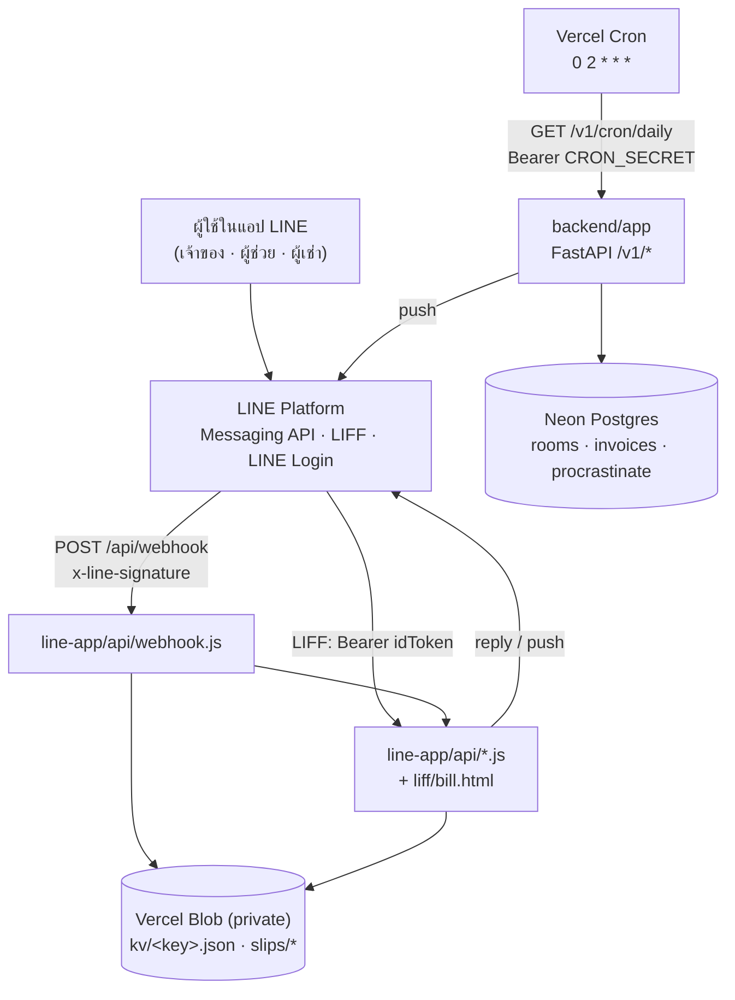

<!-- generated-by: gsd-doc-writer -->

# สถาปัตยกรรมระบบ DormPlus

เอกสารนี้อธิบายสถาปัตยกรรมระดับ repo ของทั้งโปรเจกต์ (ทั้ง `line-app/` และ `backend/`)
ถ้าต้องการรายละเอียดเชิงลึกของครึ่ง LINE app (key map ของ Blob, state machine ของบิล, ตารางสิทธิ์)
อ่านที่ [`line-app/docs/ARCHITECTURE.md`](../line-app/docs/ARCHITECTURE.md) — เอกสารนี้จะไม่เขียนซ้ำ

## 1. ภาพรวมระบบ

DormPlus เป็นระบบออกบิลและแจ้งเตือนค่าเช่าหอพัก ที่ผู้ใช้ปลายทางทั้งหมดอยู่ใน LINE:
เจ้าของจดมิเตอร์ → ระบบออกบิล → ผู้เช่าเห็นการ์ดบิลในแชท → แนบสลิป → เจ้าของยืนยัน

repo นี้มี **สอง stack ที่เป็นอิสระจากกันโดยสมบูรณ์** และตั้งใจให้เป็นแบบนั้น:

| stack | ภาษา/runtime | ที่เก็บสถานะ | ทางเข้า | สถานะ |
|---|---|---|---|---|
| `line-app/` | Node (CommonJS) บน Vercel serverless | Vercel Blob | LINE Messaging API webhook + LIFF | ใช้งานจริง — เป็นตัวที่ผู้ใช้เห็น |
| `backend/` | Python 3.11+ / FastAPI บน Vercel serverless | Neon Postgres | HTTP `/v1/*` (+ LIFF ของตัวเองที่ `/liff`) | deploy แล้ว ยังไม่มี UI เจ้าของ |

รูปแบบสถาปัตยกรรม: *stateless serverless functions + ที่เก็บสถานะภายนอก* — ทั้งสองฝั่งไม่มี process
ที่รันค้าง ไม่มี middleware กลาง และไม่มี shared code ระหว่างกัน

### ทำไมสอง stack ไม่เรียกหากัน

ไม่ได้เป็นเพราะข้อจำกัดทางเทคนิค แต่เป็นเพราะทั้งคู่ถูกสร้างเป็น **implementation คู่ขนานของโดเมนเดียวกัน**
คนละรอบเวลา:

1. **ไม่มีโค้ดฝั่งใดอ้างถึงอีกฝั่งเลย** — grep ทั้ง repo ไม่พบ URL ของ backend ใน `line-app/` และไม่พบ
   hostname ของ line-app ใน `backend/` · ไม่มี environment variable ตัวไหนชี้ข้าม stack
   (`line-app/api/*.js` อ่านแค่ env ของ LINE/Blob/ROOMS · `backend/app/config.py` อ่านแค่ DB/LINE/cron/session)
2. **ไม่มีสัญญาข้อมูลร่วมกัน** — `line-app/` ระบุห้องด้วยรายชื่อใน env `ROOMS`
   (`line-app/api/_rooms.js`, ค่าเริ่มต้น `201`–`212`) ขณะที่ `backend/` เก็บห้องในตาราง `rooms`
   ของ Postgres (`db/schema.sql`) · `line-app/` เก็บบิลเป็นไฟล์ JSON ใต้ `bill:<room>`
   (`line-app/api/_bills.js`) ขณะที่ `backend/` เก็บเป็นแถวใน `invoices`
3. **คนละบทบาทใน lifecycle** — `docs/HANDOFF.md` ระบุชัดว่า `line-app/` คือของที่ผู้ใช้เห็นอยู่ตอนนี้
   ส่วน `backend/` เป็นเป้าหมายระยะยาวตามสัญญา [`docs/API.md`](./API.md) (บรรทัด 22 ของ HANDOFF)
4. **backend ไม่รับ event จาก LINE** — `backend/app/main.py` ประกอบ router แค่
   auth · rooms · billing · me · dunning · cron · invites · ไม่มี webhook (`POST /webhooks/line/:property_id`
   ยังเป็น ⬜ ใน `docs/API.md`) ส่วน `line-app/api/webhook.js` เป็นที่เดียวที่รับ event
5. **ทางออกของ backend คือ push เท่านั้น** — `backend/app/line_push.py` เรียก
   `POST https://api.line.me/v2/bot/message/push` และไม่รู้จัก state ที่ line-app เขียนไว้

ผลที่ตามมาในทางปฏิบัติ: การแก้บิลใน stack หนึ่งไม่กระทบอีก stack, ไม่มี distributed transaction,
และไม่มี single source of truth ของ "บิลห้อง 203 รอบ 2026-11" — มีสองชุดแยกกันอยู่

<!-- VERIFY: ทั้งสองโปรเจกต์ Vercel (line-app-iota.vercel.app และ line-backend-ten.vercel.app) deploy จาก repo เดียวกันด้วย Root Directory คนละโฟลเดอร์ — ข้อความนี้มาจาก README/docs/HANDOFF ไม่ใช่จากไฟล์ config ในเรพ (vercel.json ไม่มีฟิลด์ root directory) -->

## 2. แผนผังองค์ประกอบ



อ่านแผนผัง: มีสองเส้นทางที่แยกกันโดยสิ้นเชิง — เส้นบน (LINE → `line-app/` → Blob) และเส้นล่าง
(Vercel Cron → `backend/` → Postgres → push) ทั้งสองเส้นบรรจบกันที่ LINE platform เท่านั้น
ไม่มีลูกศรระหว่าง `line-app/` กับ `backend/`

## 3. LINE platform คือทางเข้าเดียวของผู้ใช้

ผู้ใช้ไม่มีทางเข้าถึงระบบได้นอกจากผ่าน LINE และมีกลไกของ LINE สามตัวที่ถูกใช้ แต่อยู่คนละฝั่ง:

| กลไก | ใครใช้ | ที่อยู่ในโค้ด |
|---|---|---|
| Messaging API webhook | `line-app/` เท่านั้น (รับ event: follow, ข้อความ `บิล`, postback ยืนยัน) | `line-app/api/webhook.js` |
| LIFF (หน้าเว็บใน LINE) | ทั้งสอง stack — คนละหน้า คนละ LIFF id | `line-app/liff/bill.html` · `backend/liff/index.html` |
| LINE Login (idToken) | ทั้งสอง stack ตรวจ idToken กับ `oauth2/v2.1/verify` | `line-app/api/_auth.js` · `backend/app/line.py` |

**ฝั่ง `line-app/`** (รายละเอียดเต็มอยู่ใน [`line-app/docs/ARCHITECTURE.md`](../line-app/docs/ARCHITECTURE.md)):

- หน้าเดียว `liff/bill.html` ให้บริการทั้งเจ้าของ ผู้ช่วย และผู้เช่า โดยตัดสินบทบาทจาก `GET /api/me`
  (`line-app/api/me.js` คืน `role: "owner" | "viewer" | null`) — ไม่มีหน้าแยกต่อบทบาท
- webhook ตรวจ `x-line-signature` จาก body ดิบด้วย HMAC-SHA256 (`line-app/api/_line.js`) ก่อนแตะข้อมูลใด ๆ
- การส่งข้อความกลับใช้ `reply()` เมื่อมี replyToken และ `push()` เมื่อต้องหาคนที่ไม่ได้เป็นคนกด

**ฝั่ง `backend/`** ไม่มี webhook และไม่รับ event: การคุยกับ LINE มีทิศทางเดียวคือ push
(`backend/app/line_push.py`) ซึ่งถูกเรียกจาก task ในคิวเท่านั้น (`backend/app/tasks.py`)

> มี LIFF สองใบที่ห้ามสับสน: `line-app/liff/bill.html` คือใบที่ OA ใช้จริง ส่วน
> `backend/liff/index.html` เป็นหน้าของ stack backend (เรียก `/v1/*` ด้วย cookie) และยังไม่ผูกกับ OA
> — ดูหมายเหตุใน `docs/HANDOFF.md`

## 4. ที่เก็บสถานะ: Blob กับ Postgres

ทั้งสอง stack ใช้ที่เก็บต่างชนิดกันโดยสิ้นเชิง และไม่มีตัวใดอ่านข้อมูลของอีกตัว

### 4.1 `line-app/` → Vercel Blob แบบ private

ใช้ Blob เป็น key-value store: หนึ่ง key = หนึ่งไฟล์ JSON ใต้พาธ `kv/` และรูปสลิปแยกที่ `slips/`
(`line-app/api/_store.js` — `pathOf()` แปลง key เป็น `kv/${key.replace(/[^a-zA-Z0-9._-]/g,"-")}.json`)

| ข้อมูล | key | pathname จริง |
|---|---|---|
| ผู้ใช้ผูกห้อง | `user-room:<userId>` | `kv/user-room-<userId>.json` |
| ห้องผูกผู้ใช้ | `room-user:<room>` | `kv/room-user-<room>.json` |
| บิลล่าสุดของห้อง | `bill:<room>` | `kv/bill-<room>.json` |
| บิลย้อนหลัง | `bill:<period>:<room>` + index `bills:<room>` | `kv/bill-<period>-<room>.json` |
| มิเตอร์ล่าสุด | `meter:<room>` | `kv/meter-<room>.json` |
| สิทธิ์เจ้าของ/ผู้ช่วย | `owner:<userId>` | `kv/owner-<userId>.json` |
| QR ผูกห้อง | `room-qr:<room>` / `qr-code:<code>` | `kv/room-qr-<room>.json` ฯลฯ |
| รูปสลิป | `slips/<room>-<ts>.<ext>` | pathname เดียวกัน (ไม่อยู่ใต้ `kv/`) |

ทุกการอ่านระบุ `useCache: false` และทุกการเขียนเป็น `allowOverwrite: true` — ไม่มี transaction,
ไม่มี conditional write ดังนั้นรูปแบบ "อ่าน–แก้–เขียน" จึงเป็น race ได้ (ดูข้อจำกัดใน
[`line-app/docs/ARCHITECTURE.md`](../line-app/docs/ARCHITECTURE.md) ข้อ 10)

<!-- VERIFY: Blob store ถูกผูกกับโปรเจกต์ Vercel ผ่าน OIDC (ไม่มีการใส่ token ในโค้ด) และชื่อ store/env มาจากการตั้งค่าบน Vercel ไม่ใช่จากไฟล์ในเรพ — โค้ดเรียก @vercel/blob โดยไม่ระบุ token -->

### 4.2 `backend/` → Neon Postgres

schema อยู่ที่ `db/schema.sql` (snapshot อ่านอย่างเดียว) แต่ **ตัวที่รันจริงคือ Alembic migration**
ใน `backend/migrations/versions/` (`0001_initial_schema.py`, `0002_link_codes.py`, `0003_auth_failures.py`)

| กลุ่มตาราง | ตาราง | ใช้ทำอะไร |
|---|---|---|
| โดเมนหอพัก | `properties`, `rooms`, `tenants` | หอ/ห้อง/ผู้เช่า · `tenants.line_user_id` คือจุดผูก LINE |
| มิเตอร์และบิล | `readings`, `invoices`, `invoice_items` | `UNIQUE(room_id, period)` กันบิลซ้ำที่ระดับ DB |
| การชำระเงิน | `payments` | `verify_ok` เป็น `null` = ยังไม่มีใครตรวจ (manual) |
| การสื่อสาร | `message_log` | ใช้กันส่งทวงซ้ำ: นับเฉพาะแถวที่ `line_status = 'ok'` |
| ความปลอดภัย | `link_codes`, `auth_failures`, `audit_log` | รหัสเชิญ (เก็บเฉพาะ SHA-256), rate limit การเดารหัส, audit trail |
| คิว | ตารางของ Procrastinate (สร้างโดย `python -m app.queue`) | job queue ฝังใน Postgres ตัวเดียวกับโดเมน |

RLS ทำงานจริงตั้งแต่ migration `0004`: ทุก connection ถูกปักหมุดที่หอเดียวด้วย `app.property_id`
(`backend/app/db.py` → `attach_property`) และ policy เทียบ `property_id` กับค่านั้น · ใช้
`force row level security` เพราะ app ต่อด้วย user ที่เป็นเจ้าของตาราง (เจ้าของข้าม policy ได้ถ้าไม่ force)
ตารางลูก (`tenants`, `readings`, `invoices`, `invoice_items`, `payments`, `message_log`) ไม่มีคอลัมน์
`property_id` จึงเดินขึ้นไปที่ `rooms` ผ่าน FK ใน policy · `auth_failures` ไม่มี RLS (ผูกกับบัญชี LINE ไม่ใช่หอ)
การกรองในโค้ดยังอยู่ครบ — RLS เป็นชั้นกันพลาด ไม่ได้แทนที่

<!-- VERIFY: ฐานข้อมูลจริงคือ Neon Postgres ที่สร้างผ่าน Vercel Marketplace — ข้อความนี้มาจาก backend/README.md และ docs/HANDOFF.md ไม่สามารถยืนยันได้จากเรพ (connection string อยู่ใน backend/.env ที่ไม่ถูก commit) -->

## 5. คิวงานและ Vercel Cron (backend)

backend ใช้ **Procrastinate** เป็นคิวที่เก็บใน Postgres ตัวเดียวกับข้อมูลโดเมน ไม่มี broker แยก
และไม่มี worker process ที่ต้อง host:

- `backend/app/queue.py` — สร้าง `procrastinate.App` สองตัว: `app` (sync connector, ใช้ตอน enqueue)
  และ `async_app` (async connector, ใช้ตอน drain เพราะ `run_worker` ต้องมี event loop)
  · `apply_schema()` สร้างตารางของ Procrastinate เพราะ CLI ไม่รับ sync connector
- `backend/app/tasks.py` — task เดียวที่คุยกับ LINE: `line.push_text` (`retry=3`) เขียนทุกความพยายามลง
  `message_log` และ raise `PushFailed` เมื่อ LINE ไม่รับ เพื่อให้คิว retry
- `backend/app/dunning.py` — `due_for_reminder()` เลือกบิล `unpaid` ที่เลยกำหนด 1 / 5 / 10 วัน และยังไม่มี
  แถว `message_log` ที่ `line_status='ok'` ของ kind นั้น · `queue_reminders()` แค่ `defer()` เข้าคิว
- `backend/vercel.json` — ตั้ง cron ไว้ `{ "path": "/v1/cron/daily", "schedule": "0 2 * * *" }`
- `backend/app/routes/cron.py` — `GET /v1/cron/daily`: ตรวจ `Authorization: Bearer <CRON_SECRET>`
  ด้วย `hmac.compare_digest` → `due_for_reminder()` → `queue_reminders()` → `drain_queue()` → ตอบ
  `{queued, drained}`

จุดสำคัญทางสถาปัตยกรรม: **enqueue และ drain เกิดใน invocation เดียวกัน** — `drain_queue()` เรียก
`run_worker_async(wait=False, concurrency=4, listen_notify=False)` แล้วจบเมื่อคิวว่าง
(`backend/app/routes/cron.py`) จึงไม่ต้องมี host สำหรับ worker · งานที่ยังไม่ถูกหยิบเมื่อ function ถูกตัด
จะยังอยู่ในตารางและถูกหยิบในรอบถัดไป (at-least-once) ซึ่งเป็นเหตุผลที่ task ต้อง idempotent

ทางเลือกที่ยังเปิดอยู่: รัน `procrastinate -a app.queue.app worker` เป็น process ค้างบน Fly/Railway/VM
ชี้ Postgres ตัวเดียวกัน (ระบุไว้ใน docstring ของ `backend/app/queue.py`)

`POST /v1/dunning/run` (`backend/app/routes/dunning.py`) ยังอยู่สำหรับสั่ง enqueue อย่างเดียวด้วยมือ
และ **ปฏิเสธ token ที่มาใน query string** โดยตั้งใจ (URL หลุดเข้า access log)

<!-- VERIFY: Vercel Hobby รัน cron ได้วันละครั้ง คลาดได้ถึง ±59 นาที และ function มีเพดาน 300 วินาที — เป็นข้อจำกัดของแพลตฟอร์ม ไม่ได้ประกาศในเรพ (อ้างจากคอมเมนต์ใน backend/app/routes/cron.py และ backend/README.md) -->
<!-- VERIFY: cron นี้ถูกเปิดใช้งานจริงบนโปรเจกต์ Vercel หรือไม่ และ CRON_SECRET ถูกตั้งบนโปรเจกต์แล้วหรือยัง — vercel.json แค่ประกาศ schedule ไม่ได้ยืนยันสถานะ deployment -->

## 6. เส้นทาง request ที่มีจริง

### 6.1 ออกบิล → Flex card → LIFF แนบสลิป → เจ้าของยืนยัน (`line-app/`)

1. เจ้าของเปิด LIFF → `GET /api/rooms` (`line-app/api/rooms.js`) ได้ทุกห้อง + config + meter + bill + tenant
2. กรอกหน่วยน้ำ/ไฟ แล้วกดออกบิล → `POST /api/run` (`line-app/api/run.js`)
   - ตรวจ `requireUser` → `isOwner` → `readings` ไม่ว่าง → `period` ตรง `^\d{4}-(0[1-9]|1[0-2])$`
   - ต่อห้อง: `configFor(room)` → คูณหน่วยเป็นบาท → เขียน `meter:<room>` และ `saveBill()` (เขียนทั้ง
     `bill:<period>:<room>` และ `bill:<room>`) → ถ้ามี `room-user:<room>` ก็ `push()` การ์ด `billBubble()`
   - บิลที่ `pending`/`paid` อยู่แล้วถูกข้าม ไม่ถูกรีเซ็ตเป็น `unpaid`
3. การ์ดบิลในการ์ด LINE มีปุ่มเปิด LIFF ของบิลนั้น (`_line.billBubble(bill, baseUrl)`)
4. ผู้เช่าแนบสลิป → `POST /api/slip` (`line-app/api/slip.js`): ตรวจสิทธิ์รายห้อง → บิล `paid` ตอบ 409 →
   จำกัด 5 ครั้ง/บิล ห่าง ≥ 30 วินาที → อัปโหลดรูป (≤ 3MB, JPEG/PNG/WEBP) ไป `slips/<room>-<ts>.<ext>` →
   `saveBill({...bill, status:"pending", slipPath, slipAt, slipCount})` → `push()` การ์ด `confirmBubble()` หาเจ้าของ
5. เจ้าของกด "ยืนยันการชำระ" → postback `action=confirm&room=…&period=…` → `POST /api/webhook`
   → `webhook.js` ตรวจ `x-line-signature` → `isOwner(userId)` → บิลต้องเป็น `pending` →
   `saveBill({...bill, status:"paid", paidAt, confirmedBy})` → `push()` แจ้งผู้เช่า → `reply()` ยืนยัน
6. ดูรูปสลิป: `GET /api/slip-image?room=` → ตรวจสิทธิ์ → `getFile()` แบบ private → stream กลับ

bil object ถูกเขียนทับทั้งก้อนทุกครั้ง (ไม่มี event log) — state machine เต็มอยู่ใน
[`line-app/docs/ARCHITECTURE.md`](../line-app/docs/ARCHITECTURE.md) ข้อ 5

### 6.2 ผูกผู้เช่า → session cookie → อ่านเฉพาะห้องตัวเอง (`backend/`)

1. เจ้าของสร้างรหัสเชิญ → `POST /v1/rooms/{room_id}/invite` (`backend/app/routes/invites.py`)
   - รหัส 8 ตัวจาก alphabet ที่ไม่มีตัวคล้ายกัน (`backend/app/invites.py`), เก็บเฉพาะ `sha256`
   - TTL 7 วัน, ใช้ได้ครั้งเดียว, ออกรหัสใหม่จะ revoke รหัสเก่าที่ยังไม่ใช้ของ tenant คนนั้น
   - คืน `link_url = https://liff.line.me/{LIFF_ID}?code=…` (เป็น `null` ถ้าไม่ได้ตั้ง `LIFF_ID`)
2. ผู้เช่าสแกน QR → เปิด LIFF → `liff.getIDToken()` → หน้าเว็บเรียก `POST /v1/auth/line/link`
   (`backend/liff/index.html` → `backend/app/routes/auth.py` `link_with_line`)
   - ตรวจ `attempts.ensure_not_blocked()` (ผิดได้ 10 ครั้ง/ชม./บัญชี LINE, `backend/app/attempts.py`)
   - `verified_line_user()` → `line.verify_id_token(id_token, LINE_CHANNEL_ID)` (ตรวจ `aud` ด้วย)
   - ใน transaction เดียว: `select … from link_codes where code_hash = :hash for update` →
     ตรวจ `used_at` / `revoked_at` / `expires_at` → ผูก `tenants.line_user_id` (หรือเพิ่ม tenant ใหม่
     กรณีรูมเมท) → mark code used → `insert into audit_log`
3. `start_tenant_session()` เซ็น cookie `dp_session` ด้วย `SESSION_SECRET`
   (`backend/app/session.py`: HMAC-SHA256, `exp` 7 วัน, HttpOnly, SameSite=Lax, `secure` ตาม `COOKIE_SECURE`)
4. ทุก request ถัดไป: `current_session()` (`backend/app/auth.py`) อ่าน cookie → `unsign()` →
   ถ้า `role == "tenant"` เรียก `still_linked()` ตรวจกับ DB ทุกครั้ง (join `tenants` × `rooms` +
   `moved_out is null or > current_date`) — ถ้าถูกถอด LINE หรือย้ายออก ตอบ 401 `SESSION_REVOKED` ทันที
5. อ่านข้อมูล: `GET /v1/me/invoices` ใช้ `tenant_session` และเอา `room_id` จาก session เท่านั้น
   (`backend/app/routes/me.py`) · การแนบสลิป `POST /v1/invoices/{id}/slip` ใช้ `OWN_INVOICE_SQL`
   ที่บังคับ `room_id = session.room_id` (`backend/app/routes/billing.py`)
6. ฝั่งเจ้าของ: `GET /v1/rooms`, `PUT /v1/rooms/{id}/reading`, `POST /v1/billing/run`, `GET /v1/invoices`,
   `POST /v1/invoices/{id}/confirm|reject` ใช้ `owner_session` และกรอง `property_id` จาก session เสมอ

`line-app/` มีการผูกห้องของตัวเองแบบคู่ขนาน (`GET/POST /api/qr?room=` ใน `line-app/api/qr.js`,
code เก็บใน Blob key `qr-code:<code>`, หน้าตา LIFF รับ `?bind=`) — เป็นคนละ implementations
คนละที่เก็บข้อมูล ไม่เกี่ยวกับ `link_codes` ของ backend

## 7. Trust boundaries

| ขอบเขต | กลไก | ไฟล์ | เมื่อไม่ผ่าน |
|---|---|---|---|
| LINE → webhook | HMAC-SHA256 ของ body ดิบ เทียบ `x-line-signature` | `line-app/api/_line.js` (`verify`) | 401 `bad signature` |
| LIFF → `line-app` API | `Authorization: Bearer <idToken>` → `POST oauth2/v2.1/verify` กับ `CHANNEL_ID` | `line-app/api/_auth.js` (`requireUser`) | 401 ไม่มี token · 403 token ผิด/หมดอายุ |
| dev bypass (`line-app`) | header `x-seed-token` เท่ากับ `SEED_TOKEN` (≥ 16 ตัว) **และ** `BYPASS_ALLOWED` | `line-app/api/_auth.js` (`seedTokenOk`) | production ปฏิเสธเสมอ |
| บทบาทใน `line-app` | `OWNER_USER_ID` (root) หรือ key `owner:<userId>` ที่มี `role` | `line-app/api/_auth.js` (`roleOf`, `isOwner`, `canView`, `isRoot`) | 403 · viewer อ่านได้แต่ออกบิล/ยืนยัน/เชิญไม่ได้ |
| ผู้ใช้ → `backend` | signed cookie `dp_session` (HMAC ด้วย `SESSION_SECRET`) | `backend/app/session.py` (`sign`/`unsign`) | cookie ปลอม/หมดอายุ = ตกลงไปที่ 401 |
| session ผู้เช่า → DB | ตรวจ `still_linked()` ทุก request (ไม่รอ cookie หมดอายุ) | `backend/app/auth.py` | 401 `SESSION_REVOKED` |
| role ใน `backend` | `owner_session` / `tenant_session` เป็น dependency ของ route | `backend/app/auth.py` | 403 `FORBIDDEN` |
| รหัสเชิญ | เก็บเฉพาะ hash · ใช้ครั้งเดียว · TTL 7 วัน · rate limit 10 ครั้ง/ชม. | `backend/app/invites.py`, `backend/app/attempts.py` | 404 / 409 / 410 / 429 |
| cron → `backend` | `Authorization: Bearer <CRON_SECRET>` เทียบด้วย `hmac.compare_digest`; token ใน query ถูกปฏิเสธ | `backend/app/routes/cron.py`, `.../dunning.py` | 401 `UNAUTHORIZED` |

ข้อสังเกตที่ควรรู้:

- **`x-seed-token` มีอยู่เฉพาะใน `line-app/`** · `backend/` ไม่มี bypass แบบนั้น แต่มี `DEV_AUTH`
  (header `X-Dev-Property`/`X-Dev-Role`) ซึ่งถูกปิดโดยอัตโนมัติเมื่อ `VERCEL_ENV=production`
  (`backend/app/config.py` — `dev_auth_active`)
- **`CRON_SECRET` มีอยู่เฉพาะใน `backend/`** · `line-app/` ไม่มี cron และไม่มี shared secret ระดับนั้น
  (มีแค่ `SEED_TOKEN` สำหรับ dev) · `backend` ยังรับชื่อเก่า `DUNNING_TOKEN` ผ่าน `AliasChoices`
- **session ของเจ้าของใน `backend` ไม่ถูก re-check กับ DB** — `still_linked()` ทำงานเฉพาะ
  `role == "tenant"` · ทั้งนี้ `POST /v1/auth/line` ออกได้แค่ session ผู้เช่า และ **ไม่มี endpoint login
  สำหรับเจ้าของ** ดังนั้นใน production เส้นทาง `/v1/*` ของเจ้าของจึงเข้าถึงได้ทางเดียวคือ `DEV_AUTH`
  ซึ่งถูกปิดบน production (ข้อจำกัดนี้สะท้อนใน `docs/HANDOFF.md` ที่ยังไม่มี UI เจ้าของ)
- **การยืนยันสลิปไม่มี CSRF/nonce** ทั้งสองฝั่ง — `line-app` กันด้วยการตรวจ `isOwner` ใน postback
  แต่ replay ของ event เดิมยังทำได้จนบิลเป็น `paid`
- **ห้ามรับ `property_id` จาก client** — เป็นกติกากลางที่เขียนไว้ใน `backend/app/auth.py` และ
  `docs/HANDOFF.md` ทุก query ใช้ค่าจาก session

## 8. Abstraction หลัก

| Abstraction | ที่อยู่ | หน้าที่ |
|---|---|---|
| `get` / `set` / `keysWith` | `line-app/api/_store.js` | ทางเดียวที่โค้ดส่วนใหญ่แตะ Blob (ยกเว้นไฟล์รูปที่เรียก `putFile`/`getFile`) |
| `saveBill(bill)` | `line-app/api/_bills.js` | เขียน `bill:<period>:<room>` + index + `bill:<room>` พร้อมกัน และไม่ให้รอบเก่าทับรอบใหม่ |
| `requireUser(req,res)` | `line-app/api/_auth.js` | คืน LINE userId หรือตอบ 401/403 เองแล้วคืน `null` |
| `roleOf` / `isOwner` / `canView` / `isRoot` | `line-app/api/_auth.js` | three-tier สิทธิ์: root owner / owner / viewer |
| `billBubble` / `confirmBubble` | `line-app/api/_line.js` | สร้าง Flex JSON ล้วน ไม่มี side effect (เทสต์ offline ได้) |
| `mapLimit(list, n, fn)` | `line-app/api/_async.js` | จำกัด concurrency ตอนวนหลายห้อง (กัน function หมดเวลา) |
| `current_session` | `backend/app/auth.py` | แปลง cookie/DEV headers เป็น `Session(user_id, role, property_id, room_id)` |
| `sign` / `unsign` | `backend/app/session.py` | session cookie แบบ signed-not-encrypted ด้วย stdlib HMAC |
| `ApiError` + `install(app)` | `backend/app/errors.py` | บังคับ error ทุกแบบให้เป็น `{"error":{"code","message"}}` ตาม `docs/API.md` |
| `due_for_reminder` / `queue_reminders` | `backend/app/dunning.py` | แยก "เลือกบิล" (ทดสอบได้ ไม่แตะคิว) ออกจาก "ส่งเข้าคิว" |
| `line.push_text` task | `backend/app/tasks.py` | task เดียวที่ส่งข้อความ และบันทึก `message_log` ทุกครั้ง |
| `drain_queue()` | `backend/app/routes/cron.py` | ส่งจนคิวว่างแล้วจบใน invocation เดียว (`run_worker_async(wait=False)`) |
| `get_settings()` / `get_engine()` | `backend/app/config.py` · `backend/app/db.py` | `lru_cache` ระดับ process, inject ผ่าน `Depends` เพื่อให้ test สลับได้ |
| `today()` | `backend/app/clock.py` | วันนี้ตามเวลาไทย (UTC+7) และ `period` = `YYYY-MM` |

## 9. โครงสร้างไดเรกทอรีและเหตุผล

```text
pakdee-prototype/
├─ line-app/               # stack ที่ใช้งานจริง: Node serverless + Blob
│  ├─ api/                 # 1 ไฟล์ = 1 serverless function (ชื่อไฟล์คือ route)
│  │  ├─ _*.js             # helper ที่ require() กันตรง ๆ (ไม่ใช่ endpoint)
│  │  └─ *.js              # endpoint: webhook, me, bill, slip, rooms, run, qr, owner, …
│  ├─ liff/bill.html       # UI เดียวของ stack นี้ (ไม่มี build, inline JS/CSS)
│  ├─ scripts/             # สคริปต์ rich menu (setup-richmenu.js, set-richmenu-image.js)
│  ├─ docs/                # เอกสารเฉพาะ stack นี้
│  └─ vercel.json          # rewrite / → /liff/bill.html + security headers
├─ backend/                # stack เป้าหมาย: FastAPI + Postgres
│  ├─ api/index.py         # entrypoint ของ Vercel (จาก app.main import app)
│  ├─ app/                 # main, config, db, auth, session, line, queue, tasks, dunning
│  │  └─ routes/           # auth, rooms, billing, me, dunning, cron, invites
│  ├─ liff/index.html      # หน้า LIFF ผู้เช่าของ stack นี้ (เสิร์ฟที่ /liff)
│  ├─ migrations/          # Alembic (schema จริงที่รัน)
│  ├─ tests/               # pytest (ต้องมี Postgres)
│  └─ vercel.json          # crons: GET /v1/cron/daily
├─ db/schema.sql           # snapshot ของ schema Postgres (อ่านอย่างเดียว)
├─ docs/                   # API contract, HANDOFF, เอกสารระดับ repo
├─ scripts/prod-smoke.mjs  # ตรวจ production ทั้งสองโปรเจกต์
└─ Dockerfile              # image ของ backend (Railway/Cloud Run)
```

เหตุผลที่แบ่งแบบนี้:

- **แบนราบตาม platform ไม่ใช่ตาม layer** — ทั้งสอง stack ใช้ "ไฟล์ = route" ของ Vercel
  ไม่มี routing layer หรือ bundler · ใน `line-app/` ไฟล์ที่ขึ้นต้นด้วย `_` คือ shared module
  (ต้องเป็น CommonJS เพราะ `require()` กันตรง ๆ)
- **ชอบรวมไฟล์เพราะมีเพดานจำนวน function** — `api/qr.js` รวม GET/POST ของ QR ไว้ไฟล์เดียว และ
  `api/owner.js` รวม GET/POST/DELETE ของสิทธิ์เจ้าของ เพราะแผน Vercel ที่ใช้จำกัดจำนวน function
  ต่อ deployment (เหตุผลระบุในคอมเมนต์หัวไฟล์ทั้งสอง)
- **business rules อยู่ใกล้ที่เก็บข้อมูล** — `line-app/` คำนวณเงินใน `api/run.js` จาก `configFor()`;
  `backend/` คำนวณใน `POST /v1/billing/run` จากแถว `properties.water_rate`/`elec_rate`/`due_days`
  และเขียน `invoice_items` ใน transaction เดียว
- **`db/schema.sql` เป็นเอกสาร ไม่ใช่ตัวรัน** — หัวไฟล์ระบุว่า source of truth คือ
  `backend/migrations/` · การแก้ schema ต้องเพิ่ม migration ใหม่ ไม่ใช่แก้ snapshot

## 10. ข้อจำกัดเชิงสถาปัตยกรรม

1. **ไม่มี single source of truth** — บิลของผู้ใช้จริงอยู่ใน Blob (`line-app/`) ส่วนบิลใน Postgres
   (`backend/`) ถูกสร้างด้วย seed/migration แยกกัน · การย้ายข้อมูลข้าม stack ยังไม่มีเครื่องมือในเรพ
2. **`line-app/` ไม่มี transaction** — เขียนทับทั้งไฟล์ ไม่มี lock (รายละเอียดใน
   [`line-app/docs/ARCHITECTURE.md`](../line-app/docs/ARCHITECTURE.md) ข้อ 10)
3. **`backend/` ไม่มีทางเข้าเจ้าของบน production** — ไม่มี owner login, `DEV_AUTH` ถูกปิดบน production
   (ดูข้อ 7)
4. **RLS เปิดแต่ไม่มี policy** — การแยกหอพักพึ่ง `property_id` ที่กรองในโค้ดทุก query เท่านั้น
5. **ไม่มี webhook ฝั่ง backend** — backend ส่งได้อย่างเดียว ไม่รับ event · ถ้าต้องการผูก OA เข้ากับ
   backend ต้องสร้าง `POST /webhooks/line/:property_id` (ยังเป็น ⬜ ใน `docs/API.md`)
6. **ตรวจสลิปเป็น manual ทั้งสองฝั่ง** — `payments.verify_ok` เป็น `null` จนเจ้าของกดยืนยัน
   และ `line-app/` ก็ให้เจ้าของกด postback ยืนยันเอง
7. **จำนวนห้องไม่ตรงกัน** — `line-app/` มาจาก env `ROOMS` (ค่าเริ่มต้น 12 ห้อง `201`–`212`)
   ส่วน `backend/` seed 42 ห้อง (`backend/app/seed.py`)
8. **ไม่มี background job ใน `line-app/`** — บิลรอบใหม่เกิดเมื่อมีคนกดจากหน้าเจ้าของเท่านั้น
   คิว/ทวงอัตโนมัติมีเฉพาะใน `backend/`

## เอกสารที่เกี่ยวข้อง

- [`line-app/docs/ARCHITECTURE.md`](../line-app/docs/ARCHITECTURE.md) — สถาปัตยกรรมครึ่ง LINE app ฉบับละเอียด
  (key map, state machine, ตารางสิทธิ์, ข้อจำกัดทีละข้อ)
- [`API.md`](./API.md) — สัญญา API v1 ที่ `backend/` ยึด
- [`HANDOFF.md`](./HANDOFF.md) — งานที่เหลือและเกณฑ์ "เสร็จ" ของ backend
- [`../backend/README.md`](../backend/README.md) — endpoint, session, DEV_AUTH, Procrastinate
- [`../db/schema.sql`](../db/schema.sql) — โครง Postgres (snapshot)
