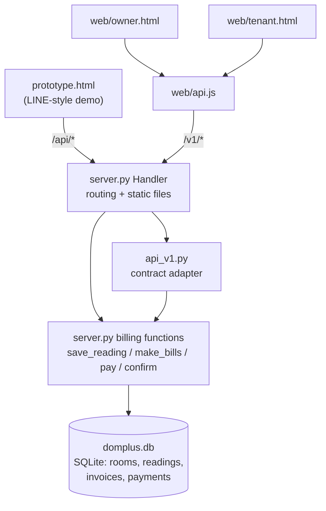

<!-- generated-by: gsd-doc-writer -->
# DormPlus — Architecture

**Status: prototype.** Everything in the "As-built" sections below runs today from `python server.py` on
`127.0.0.1:8777`. The production stack in [Planned production topology](#planned-production-topology-not-built)
does not exist in this repository. `server.py` is the reference implementation for billing rules and invoice
status — `docs/HANDOFF.md` says so explicitly, and the UI is not authoritative.

## System overview

DormPlus bills dorm rooms monthly from meter readings and chases the arrears. The owner records water and
electricity readings per room, runs billing for the whole property, and confirms tenant payment slips; the
tenant sees one invoice and attaches a slip. There is no penalty/fine logic by design — dunning is reminders
plus an arrears status.

The as-built system is a single Python process using only the standard library: `ThreadingHTTPServer` serves
static HTML, a small `/api/*` JSON surface for the original LINE-style demo page, and a `/v1/*` contract
adapter. All state lives in one SQLite file, `domplus.db`. There is no auth layer, no background worker, no
queue, and no external service call.

- Input: HTTP requests from a browser on the same machine.
- Output: HTML pages, JSON responses, rows in `domplus.db`.
- Architectural style: a static frontend plus one process that is both web server and application server,
  with the database as the only shared state.

## Runtime components

| Component | Path | Role |
|---|---|---|
| Demo server | `server.py` | `ThreadingHTTPServer` on `127.0.0.1:8777`; routing, static file serving, schema + seed, and the `/api/*` handlers (`state`, `save_reading`, `make_bills`, `pay`, `confirm`) |
| v1 adapter | `api_v1.py` | Implements the `docs/API.md` contract over the same SQLite data: `/v1/rooms`, `/v1/rooms/:id/reading`, `/v1/billing/run`, `/v1/invoices`, `/v1/invoices/:id/slip`, `/v1/invoices/:id/confirm`, `/v1/reports/summary` |
| LINE-style demo page | `prototype.html` | Single-page walkthrough of the whole flow; reads `/api/state`, posts to `/api/reading`, `/api/bill`, `/api/pay`, `/api/confirm` |
| Owner web app | `web/owner.html` | Meter entry, progress, run billing, revenue summary; served at `/owner` |
| Tenant web app | `web/tenant.html` | Shows an invoice, attaches a slip; served at `/tenant` |
| API client | `web/api.js` | The only place the frontend knows the API shape; `base = ""` (same origin) with a comment pointing at `https://api.domplus.app/v1` for production |
| Styles | `web/app.css` | Design tokens shared by both web apps |
| SQLite database | `domplus.db` | Created and seeded on first run; the file is committed in the working tree |
| Postgres DDL | `db/schema.sql` | Target schema for the real backend — not executed by anything in this repo |
| Contract + handoff | `docs/API.md`, `docs/HANDOFF.md` | API contract, error codes, state machine; backend task list and acceptance criteria |

Two facts about the wiring that matter when changing it:

- `api_v1.py` does `import server` while `server.py` is running as `__main__`, so there are two module
  objects in the process. They share state only through the `domplus.db` file, not through Python globals.
- `server.py` imports `api_v1` lazily inside the request handlers, so the adapter is only loaded on the first
  `/v1/*` request.

## Components and data flow



The adapter does not duplicate the billing rules it can reuse: `POST /v1/billing/run` calls
`server.make_bills()` directly. It does re-implement reading entry and slip/confirm, which is why the two
surfaces differ slightly (see [Billing state machine](#billing-state-machine)).

## Request flow

### Owner: record readings, then bill

1. `GET /owner` → `server.Handler._serve_static("/web/owner.html")`.
2. `web/owner.html` loads `/web/api.js`, then calls `API.rooms()` → `GET /v1/rooms` → `api_v1.rooms_payload()`.
   Response is `{items, period, rates}` where each item carries `reading` and `invoice` for the current
   period, or `null`.
3. The page computes the preview client-side (units × 25 for water, × 7 for electricity) and warns when a
   reading is lower than the previous one.
4. Saving calls `API.saveReading(roomId, {period, water_now, elec_now})` → `PUT /v1/rooms/:id/reading` →
   `api_v1.save_reading()`. It reads the previous period's `water_now`/`elec_now` as the baseline, then
   upserts on `(room_id, period)`. Re-saving overwrites `water_now`/`elec_now` until a bill exists.
5. `API.runBilling()` → `POST /v1/billing/run` → `server.make_bills()`. It bills every room that has a
   reading for the period, skips rooms without one, and inserts with
   `ON CONFLICT(room_id, period) DO NOTHING` — so a second run adds nothing instead of erroring.
6. `API.summary()` → `GET /v1/reports/summary` → `api_v1.summary()` sums `invoices.total` for the period
   into `billed`, `paid`, `pending`, `unpaid`.

### Tenant: view invoice, attach slip; owner confirms

1. `GET /tenant` → `web/tenant.html`.
2. `API.invoices()` → `GET /v1/invoices` → `api_v1.invoices_payload()`. The page takes the first item whose
   status is not `paid`, falling back to the first item.
3. "แนบสลิป & แจ้งชำระ" → `API.slip(id, slipUrl)` → `POST /v1/invoices/:id/slip` →
   `api_v1.slip()`. It inserts a `payments` row and sets the invoice to `pending`, returning
   `verify: {ok: null, amount, provider: "manual"}` — slip verification is manual in the prototype.
4. `POST /v1/invoices/:id/confirm` → `api_v1.confirm()` sets `paid`, stamps
   `payments.confirmed_at`, and returns `receipt_no` as `REC-{period}-{invoice_id:04d}`.

### The `/api/*` surface (demo page only)

`prototype.html` uses `/api/state` (GET) and `/api/reading`, `/api/bill`, `/api/pay`, `/api/confirm` (POST).
`pay` and `confirm` take `invoice_ids` arrays, so one slip can cover several invoices — the `/v1/*` contract
only handles one invoice per call. `prototype.html` also degrades gracefully: if `/api/state` fails it falls
back to an in-memory demo dataset and applies writes locally (`offlineWrite`), so the demo page still works
with no server running.

## Data model (as built, SQLite)

Four tables, created from the `SCHEMA` string in `server.py` and seeded on first run with 42 rooms
(`2xx` ×12, `3xx` ×12, `4xx` ×10, `5xx` ×8), one `2026-10` reading per room, and `2026-11` readings for the
first 12 rooms.

**`rooms`** — one row per billable room.

| Column | Type | Notes |
|---|---|---|
| `id` | INTEGER PK | |
| `property_id` | TEXT NOT NULL DEFAULT `'pro1'` | Written by the seed, never read by any query |
| `room_no` | TEXT NOT NULL | e.g. `203`; not unique in the SQLite schema |
| `rent` | INTEGER NOT NULL | 3220 for seeded rooms |
| `billing_mode` | TEXT NOT NULL DEFAULT `'meter'` | `meter` or `flat`; named `mode` in the Postgres DDL |
| `tenant_name` | TEXT | Display name only — there is no tenant table |
| `status` | TEXT NOT NULL DEFAULT `'occupied'` | |

**`readings`** — meter values per room per period. `UNIQUE(room_id, period)`.

`id`, `room_id` (FK → `rooms.id`, `ON DELETE CASCADE`), `period` (`YYYY-MM`), `water_prev`, `water_now`,
`elec_prev`, `elec_now`, `recorded_at`.

**`invoices`** — one bill per room per period. `UNIQUE(room_id, period)`.

`id`, `room_id` (FK, cascade), `period`, `rent`, `water_units`, `water_rate` (default 25), `elec_units`,
`elec_rate` (default 7), `total`, `due_date`, `status` (default `'unpaid'`). There is no `invoice_items`
table in SQLite: the bill breakdown is the denormalised `*_units` / `*_rate` columns.

**`payments`** — a slip against an invoice.

`id`, `invoice_id` (FK → `invoices.id`, cascade), `amount`, `confirmed_at` (NULL until the owner confirms),
`created_at`.

Bill arithmetic, in `server.make_bills()`: `total = rent + water_units * WATER_RATE + elec_units * ELEC_RATE`,
where units are `max(0, now - prev)`; for `billing_mode = 'flat'` units are 0 and `total = rent`. Due date is
`TODAY + 5 days`. Money is integer baht throughout — no decimals.

### Prototype vs. target schema

`db/schema.sql` is the Postgres target and is a superset. Differences a backend implementer must not assume
away:

| Prototype (SQLite) | Target (Postgres) |
|---|---|
| `rooms.property_id` only, no `properties` table | `properties` table holding rates, `due_days`, encrypted LINE credentials |
| `rooms.billing_mode` | `rooms.mode` (rates live on `properties`) |
| `rooms.tenant_name` text | `tenants` table (`room_id`, `line_user_id`, `moved_in`, `moved_out`) |
| `invoices` status ∈ `unpaid`/`pending`/`paid` | adds `void`; also `receipt_no`, `created_at`, `paid_at` |
| flat `*_units`/`*_rate` columns | `invoice_items` rows (`label`, `qty`, `unit_price`, `amount`) |
| `payments.confirmed_at` | `slip_key`, `verify_ok`, `verified_by`, `verified_at` |
| — | `message_log`, `audit_log` |
| integer `id` | text `id` |

RLS is enabled on `rooms`, `readings`, `invoices`, `invoice_items`, `payments` at the end of
`db/schema.sql`, but no `create policy` statements are defined yet — as written, those tables are
default-deny until policies are added.

## Billing state machine

```
unpaid ──tenant attaches slip──▶ pending ──owner confirms──▶ paid
   ▲                                │
   └──────── reject ────────────────┘
```

As built, only the forward edges exist:

| Transition | Where | Guard |
|---|---|---|
| `unpaid` → `pending` | `server.pay()` | `SELECT ... WHERE id=? AND status='unpaid'`, so a repeat tap adds no payment row |
| `unpaid` → `pending` | `api_v1.slip()` | **No status guard** — it sets `pending` and inserts a `payments` row for any existing invoice, including a `paid` one |
| `pending` → `paid` | `server.confirm()` | `UPDATE ... WHERE id=? AND status='pending'` |
| `pending` → `paid` | `api_v1.confirm()` | **No status guard** |
| `pending` → `unpaid` (reject) | — | Not implemented; `POST /invoices/:id/reject` is marked ⬜ in `docs/API.md` |
| any → `void` | — | Exists only in the Postgres `check` constraint; no code path sets it |

Consequences worth knowing before you build on this: because `api_v1.slip()` has no guard, a tenant page
that re-attaches a slip on an already-`paid` invoice will move it back to `pending`. The `/api/*` path
(`server.pay()`) does not have this problem. `paid` is documented as terminal ("paid แก้ไม่ได้") in `docs/API.md`; the
adapter does not enforce it.

Idempotency, where it exists, comes from the database: `UNIQUE(room_id, period)` on both `readings` and
`invoices` means re-running seeding or billing is a no-op rather than a duplicate.

## Trust boundaries and multi-tenant isolation

**As built, there are no trust boundaries inside the app.** Be explicit about this when handing the prototype
to anyone:

- The server binds `127.0.0.1` only — it is a local demo, not a deployable service.
- There is no authentication, no session, no cookie, and no `Authorization` header handling anywhere in
  `server.py` or `api_v1.py`.
- `property_id` exists as a column on `rooms` with default `'pro1'` and is never selected, filtered, or
  compared. Every query is single-property by construction because the database only contains one property.
- Resource IDs come straight from the URL path (`/v1/rooms/:id/reading`, `/v1/invoices/:id/slip`) with no
  ownership check — any caller can act on any invoice.
- `web/tenant.html` is not scoped to a tenant: it picks the first non-`paid` invoice in the whole table.
- `web/api.js` uses `credentials: "same-origin"`, so a session cookie will be sent once the real backend sets
  one, but nothing consumes it today.
- Static serving normalises the path (`os.path.normpath`) and compares it to `BASE` with `startswith`, which
  is a prefix comparison rather than a separator-aware one. It is a guard, not a hardened one.

The target model, per `docs/HANDOFF.md` and `docs/API.md`:

- LINE Login idToken → session cookie → the server resolves `property_id` **from the session, never from the
  client**. `tenant` role resolves `property_id` from the room bound to `line_user_id`.
- Every query filters on that `property_id`; RLS in Postgres is the second layer.
- Cross-property access returns `403 FORBIDDEN` (acceptance criterion: "call property A's API with property
  B's session → 403").
- LINE channel secrets and access tokens are stored encrypted (`properties.line_secret_enc`,
  `line_token_enc`) — a leaked token means sending messages as another property's OA.
- The LINE webhook verifies `X-Line-Signature` with the per-property channel secret and returns 200 before
  processing asynchronously.

## Planned production topology (not built)

None of this exists in the repository. It is the agreed target in `docs/HANDOFF.md` and `docs/API.md`; do not
import these modules or assume these services are reachable.

| Piece | Planned | Source of truth |
|---|---|---|
| API service | FastAPI implementing every endpoint and error code in `docs/API.md`, including the ⬜ rows (auth, `/properties/:id`, invoice detail, reject, webhook) | `docs/API.md` |
| Database | Postgres on Supabase per `db/schema.sql`, migrated with Alembic; seed 42 rooms | `db/schema.sql`, `docs/HANDOFF.md` |
| Queue + scheduler | Worker and cron on Procrastinate or ARQ with four jobs: `billing.run` (whole property in one transaction), `notify.invoice` (one LINE message per room, one `message_log` row each), `dunning` (daily at 1/5/10 days past due, no same-day duplicates), `slip.verify` | `docs/HANDOFF.md` |
| Tenant + owner surface | LINE Messaging API (OA), LIFF pages, rich menus (assets already in `docs/richmenu-*.png`) | `docs/HANDOFF.md` |
| Slip verification | Third-party slip verification API (SlipOK named in the handoff); unmatched amount must not auto-pass, and if the API is down the invoice stays `pending` with `verify.ok = null` for manual review | `docs/API.md`, `docs/HANDOFF.md` |
| Auth | LINE Login idToken → session cookie → `property_id` resolution | `docs/API.md` |
| Secrets | LINE channel id/secret/token per property, encrypted with KMS or pgcrypto | `db/schema.sql`, `docs/HANDOFF.md` |

<!-- VERIFY: production API base URL https://api.domplus.app/v1 appears in docs/API.md and a comment in web/api.js; no deployment or DNS configuration exists in this repository to confirm it -->
<!-- VERIFY: LIFF hosting domain and HTTPS subdomain are requested in docs/HANDOFF.md section 7; no domain or hosting config exists in this repository -->
<!-- VERIFY: Supabase and Railway access are listed as prerequisites in docs/HANDOFF.md section 7; no project, region, or connection configuration exists in this repository -->

Constraints the target inherits from the prototype, stated as rules in `docs/HANDOFF.md`: uniqueness is
enforced by the database, not by application checks; queue jobs must be idempotent because retries and cron
can fire twice; `paid` is immutable and needs void/receipt-reissue plus an `audit_log` entry; no late fees.

## What does not exist (do not assume it)

- No auth, session, or middleware of any kind.
- No LINE SDK, webhook, or outbound HTTP call — `server.py` never leaves the process.
- No queue, worker, cron, or background thread.
- No FastAPI, no Postgres connection, no ORM, no migrations. `db/schema.sql` is DDL text only.
- No `invoice_items`, `tenants`, `properties`, `message_log`, or `audit_log` table in the running database.
- No tests, no `requirements.txt`/`pyproject.toml`, no Dockerfile, no CI. Dependencies are Python 3 standard
  library only.
- No reject, void, receipt PDF, or slip verification.
