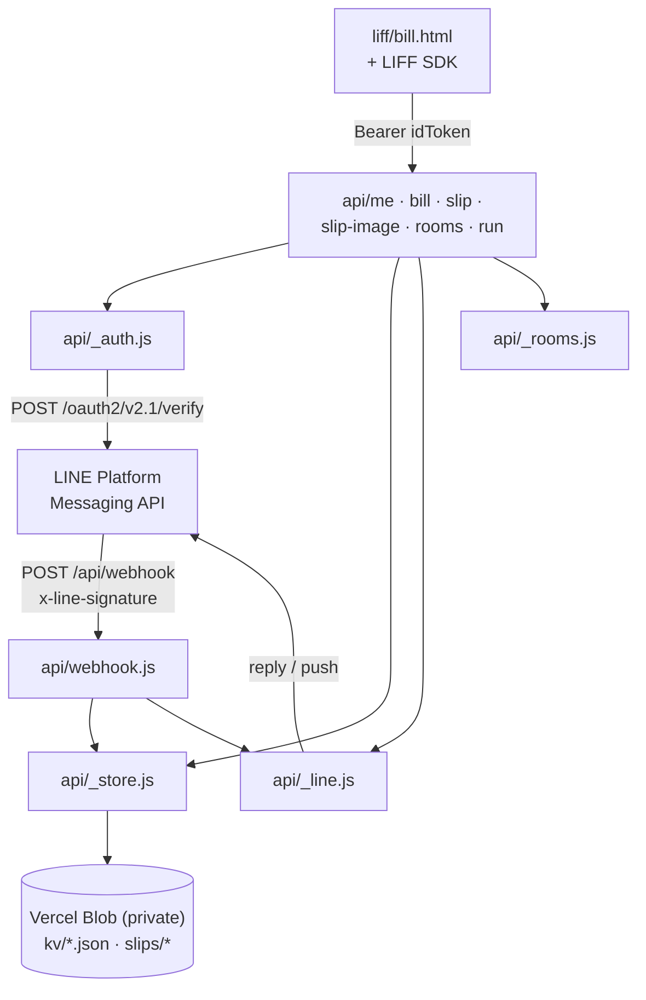
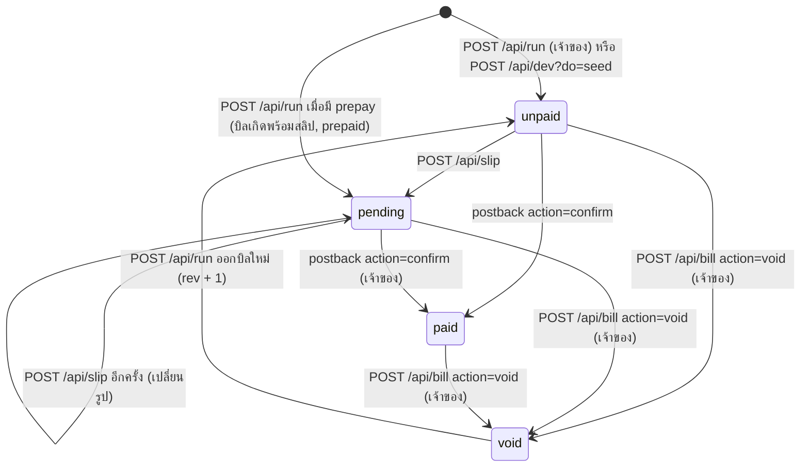

<!-- generated-by: gsd-doc-writer -->

# สถาปัตยกรรมระบบ DormPlus LINE app

## 1. ภาพรวมระบบ

ระบบนี้เป็นแอปออกบิลหอพักที่ทำงานอยู่ใน LINE ทั้งหมด: **ไม่มี framework, ไม่มีขั้นตอน build, ไม่มีฐานข้อมูล** สิ่งที่ deploy ขึ้น Vercel มีเพียงสองอย่างคือ หน้า static ไฟล์เดียว `liff/bill.html` (โหลด LIFF SDK จาก LINE) และ serverless function ภาษา CommonJS ใต้โฟลเดอร์ `api/` ที่ Vercel เปิดเป็น route ตามชื่อไฟล์ (`api/bill.js` → `/api/bill`)

อินพุตมีสองทาง: (1) LINE Messaging API ยิง webhook เข้า `POST /api/webhook` เมื่อมีข้อความ/postback และ (2) ผู้ใช้เปิดหน้า LIFF แล้วเรียก API ด้วย `Authorization: Bearer <idToken>` เอาต์พุตคือข้อความ/การ์ด Flex ที่ส่งกลับเข้าแชท LINE และ JSON ที่หน้า LIFF เอาไปวาด

สถานะทั้งหมดเก็บใน **Vercel Blob แบบ private** โดยใช้เป็น key-value store: หนึ่ง key = หนึ่งไฟล์ JSON ใต้พาธ `kv/` ส่วนรูปสลิปเก็บแยกที่ `slips/` dependency ตัวเดียวของโปรเจกต์คือ `@vercel/blob` (`package.json`)

รูปแบบสถาปัตยกรรมจึงเป็น *stateless serverless functions + external blob store* ไม่มีเลเยอร์ middleware กลาง ทุก endpoint ประกอบ `_auth` / `_store` / `_line` เองทีละไฟล์

## 2. แผนผังองค์ประกอบ



- `api/config.js` เป็น endpoint เดียวที่เปิดสาธารณะ (คืนแค่ `liffId`) ไม่ผ่าน `_auth`
- `api/dev.js` ไม่ผ่าน `requireUser` แต่ใช้ `seedTokenOk()` ของ `_auth` (header `x-seed-token`) และตอบ 404 บน production
- `_rooms.js` อ่าน `process.env.ROOMS` ตอน module load และอ่าน `room:<room>` จาก Blob ผ่าน `_store.js`

## 3. เส้นทาง request ที่มีจริง

### 3.1 แชท → webhook → reply/push

1. LINE ยิง `POST /api/webhook` พร้อม header `x-line-signature`
2. `webhook.js` อ่าน body ดิบจาก stream (`readRaw`) เพราะ signature ต้องคำนวณจาก byte จริง
3. `_line.verify()` คำนวณ `HMAC-SHA256(rawBody, LINE_CHANNEL_SECRET)` เป็น base64 แล้วเทียบตรงกับ header — ไม่ผ่านคือ `401 bad signature`
4. `JSON.parse` ไม่ผ่านคือ `400 invalid json`
5. วน `body.events` ด้วย `Promise.all` เรียก `handleEvent()` ทีละ event โดยมี `try/catch` ต่อ event (event หนึ่งพังไม่บล็อกตัวอื่น) แล้วตอบ `200 {ok:true}` หลังทุก event ทำงานเสร็จ
6. `handleEvent()` รองรับเฉพาะ:
   - `follow` → เขียน `user:<userId> = {followedAt}` แล้ว `reply()` ข้อความต้อนรับ
   - `message` ชนิด `text` ค่า `บิล`/`bill` → อ่าน `user-room:<userId>` แล้ว `bill:<room>` → `reply()` การ์ด `billBubble()`
   - `message` ชนิด `text` รูปแบบ `ผูก <เลข 2-4 หลัก>` → **ต้องมี `bill:<room>` อยู่ก่อน** ไม่งั้นตอบ "ไม่พบห้อง" แล้วเขียน `user-room:<userId>` และ `room-user:<room>` (ผูกสองทาง)
   - `postback` ที่ `action=confirm` → ดูข้อ 5
   - event ชนิดอื่นถูกเมิน (ยังตอบ 200)
7. การส่งกลับใช้ `reply(replyToken, messages)` ถ้ามี replyToken และใช้ `push(to, messages)` เมื่อต้องส่งหาคนที่ไม่ได้เป็นคนกด (เช่น แจ้งผู้เช่าว่าชำระแล้ว)

### 3.2 LIFF → idToken → API

1. เปิด `/liff/bill.html` (rewrite `/` → หน้านี้ใน `vercel.json`)
2. `boot()` เรียก `GET /api/config` (public) เอา `liffId` แล้ว `liff.init()`
3. ถ้ายังไม่ล็อกอิน → `liff.login()`; ถ้า `getIDToken()` คืนค่าว่าง → หน้าแจ้งว่า LIFF ยังไม่เปิด scope `openid`
4. `api()` ในหน้าเว็บแนบ `Authorization: Bearer <idToken>` ทุกครั้ง (และ `Content-Type: application/json` เมื่อมี body)
5. ฝั่ง server `_auth.requireUser()`:
   - ถ้า `BYPASS_ALLOWED` (`vercel dev` หรือ `ALLOW_SEED_BYPASS=true` นอก production) และ header `x-seed-token` ตรงกับ `SEED_TOKEN` (≥ 16 ตัว) → คืน `OWNER_USER_ID || "dev"` · production ไม่มี bypass
   - ถ้าไม่มี token หรือไม่มี `CHANNEL_ID` → `401 UNAUTHORIZED`
   - ถ้าไม่ตรง → `POST https://api.line.me/oauth2/v2.1/verify` ด้วย `id_token` + `client_id` = `CHANNEL_ID` แล้วเอา `payload.sub` เป็น userId; ผิด/หมดอายุ → `403 FORBIDDEN`
6. `CHANNEL_ID` = `LOGIN_CHANNEL_ID` หรือถ้าไม่ตั้งก็ใช้ prefix ของ `LIFF_ID` (ตัดที่ `-`) — คำนวณตอน module load
7. endpoint ที่ต้อง userId ของผู้ใช้เอง: `isOwner(userId)` (async) = `OWNER_USER_ID` หรือมี key `owner:<userId>` (ได้สิทธิ์จาก QR ของเจ้าของเดิม) · ส่วนผู้เช่าเทียบ `user-room:<userId>` ว่าผูกห้องหรือยัง

### 3.3 ออกรอบบิล (เจ้าของ)

1. หน้า owner view เรียก `GET /api/rooms` → ได้ทุกห้อง + `config` + `meter` + `bill` + `tenant`
2. ผู้ใช้กรอกหน่วยน้ำ/ไฟ; หน้าเว็บคำนวณยอดโชว์สด ๆ ด้วย `rent + water*waterRate + elec*elecRate`
3. กดปุ่ม → `POST /api/run` body `{period, due, readings:[{room, water, elec}]}`
4. `run.js` เช็ก `POST` + owner + `readings` ไม่ว่าง + มี `period` (จาก body, `BILL_PERIOD`)
5. ต่อห้อง: ห้องต้องอยู่ใน `ROOMS` และต้องมีทั้งหน่วยน้ำและไฟ (ขาด/ว่าง/`null` → `{ room, error: "ต้องกรอกหน่วยน้ำและไฟ" }` ไม่ใช่ 0 หน่วย; `0` ตรง ๆ ใช้ได้) → อ่านบิลเดิม/config/ผู้เช่า/prepay พร้อมกัน → ถ้าบิลรอบนี้เป็น `void` เก็บไว้ที่ `bill-void:<period>:<room>:<rev>` + `bill-voids:<room>` ก่อน → คูณหน่วยเป็นบาท (`Math.round`) → เขียน `meter:<room>` + `saveBill()` พร้อมกัน → ถ้ามี `room-user:<room>` ก็ `push()` การ์ดบิล (ไม่มี `due` = ไม่มีบรรทัดครบกำหนด; ถ้า push พังแค่ log แล้วคืน `pushed:false`)
6. ตอบกลับ `{ok, period, due, rooms:[{room,total,pushed}]}` ให้หน้าเว็บสรุป

### 3.4 แนบสลิป → เจ้าของยืนยัน → ปิดบิล

1. ผู้เช่ากด "แนบสลิป & แจ้งชำระ" → หน้าเว็บย่อรูปในเบราว์เซอร์ (`createImageBitmap` → canvas ด้านยาวสุด 1280px → `toDataURL("image/jpeg", 0.8)`) แล้ว `POST /api/slip` body `{room, image}`
2. `slip.js` ตรวจสิทธิ์ห้องเดียวกับ `bill.js`; ถ้าไม่มีบิล หรือบิลล่าสุด `paid`/`void` แล้ว → ทางโอนก่อนบิลออก: เก็บเป็น `prepay:<room>` (รูปที่ `slips/<room>-advance-<ts>.<ext>`), push ข้อความหาเจ้าของ, ตอบ `status:"advance"` — `POST /api/run` รอบถัดไปจะผูกสลิปนี้กับบิลใหม่ให้เอง
3. ถ้ามี `image`: ต้องตรง regex `data:image/(jpeg|png|webp);base64,...`, ถอด base64, เกิน 3MB → `413 TOO_LARGE`; เขียนไฟล์ด้วย `_store.putFile()` ที่ `slips/<room>-<timestamp>.<ext>` แบบ private
4. เขียน `bill:<room>` และ `bill:<period>:<room>` เป็นสถานะ `pending` พร้อม `slipPath`, `slipNote`, `slipAt`, `slipCount` (ผู้เช่าส่งได้ 5 ครั้ง/บิล ห่างกัน ≥ 30 วินาที) แล้วลบรูปสลิปเก่าที่ถูกแทน — เฉพาะเมื่อไม่มีบิลอื่นของห้องที่ยังชี้ไปที่รูปนั้น (สลิปหลายงวดแชร์รูปเดียวกัน)
5. `push()` การ์ด `confirmBubble()` หา `OWNER_USER_ID` — push พังไม่ทำให้ request ของผู้เช่าล้ม
   - **สลิปเดียวหลายงวด:** ถ้า body มี `periods: ["2026-10","2026-11"]` ทุกบิลต้องเป็น `unpaid`/`pending` ของสัญญาเช่าปัจจุบัน → ทุกบิลเป็น `pending` ด้วยรูป/`slipAt` เดียวกัน พร้อม `slipGroup: { periods, total }` และเจ้าของได้การ์ดใบเดียว (ยอดรวม ปุ่ม `periods=`)
6. เจ้าของกดปุ่ม "ยืนยันการชำระ" → postback `action=confirm&room=<room>&period=<period>` (หรือ `periods=<p1,p2>` กรณีหลายงวด) → `POST /api/webhook`
7. `webhook.js` ตรวจ `isOwner` แล้วเขียนบิลเป็น `paid` + `paidAt` + `confirmedBy` + `receiptNo` (`R<yyyymm>-<room>[-<rev>]` คำนวณจากบิล ไม่ใช้ตัวนับกลาง) แล้ว `push()` **ใบเสร็จ** (Flex `receiptBubble`) ให้ผู้เช่าจาก `room-user:<room>` และ `reply()` ยืนยันกลับ · บิล `void` ตอบ "บิลนี้ถูกยกเลิกแล้ว" ไม่เขียนอะไร · กรณี `periods=` ยืนยันเฉพาะบิลที่ยัง `pending` และ `slipGroup.periods` ตรงกับการ์ด แต่ละใบได้เลขใบเสร็จของตัวเอง (push ละไม่เกิน 5 ข้อความ)
8. ดูรูปสลิป: `GET /api/slip-image?room=` → ตรวจสิทธิ์ → `get(bill.slipPath, {access:"private", useCache:false})` → stream byte กลับพร้อม `Cache-Control: private, no-store`

### 3.5 เตือนบิลค้างรายวัน (cron)

1. Vercel Cron เรียก `GET /api/cron` วันละครั้ง (02:00 UTC = 09:00 เวลาไทย) พร้อม `Authorization: Bearer <CRON_SECRET>` — `cron.js` ตอบ `405`/`503`/`401` ถ้าไม่ใช่ GET / ไม่ได้ตั้งรหัส (≥ 16 ตัว) / รหัสไม่ตรง
2. `cron.js` หาวันนี้เวลา Asia/Bangkok แล้วเรียก `_remind.runReminders({ today, baseUrl })`
3. ต่อห้อง (ทีละ 4 ห้อง): อ่าน `bill:<room>` + `bills:<room>` พร้อมกัน → ดึงบิลรอบเก่าที่ยัง `unpaid` (ย้อนไม่เกิน 12 รอบ) → ต่อบิลที่มี `due` คำนวณ `kind` จากจำนวนวัน (`before_3` / `due_0` / `after_1` / `after_5` / `after_10`) → ข้ามที่มี `reminded:<room>:<period>:<kind>` แล้ว
4. ถ้ามีผู้เช่าผูกห้อง (`room-user:<room>`) และบิลเป็นของสัญญาเช่าปัจจุบัน → push การ์ดเตือน **หนึ่ง push ต่อห้อง** (รวมได้ไม่เกิน 5 ข้อความ) แล้วเขียน `reminded:…` ของแต่ละใบ · push พัง = ไม่เขียน รอบหน้าลองใหม่ · เขียนไม่สำเร็จแค่ log
5. ถ้ามีเตือนชนิด `after_*` push สรุปหา `OWNER_USER_ID` หนึ่งข้อความ แล้วตอบ `{ ok, today, sent, failed }`

## 4. บทบาทผู้ใช้

| บทบาท | นิยามในโค้ด | เห็นอะไร | ทำอะไรได้ |
|---|---|---|---|
| ผู้เช่า (tenant) | ผู้ใช้ที่ผูกห้องแล้ว (`user-room:<userId>` มีค่า) | บิลของห้องตัวเอง **เฉพาะที่ออกตั้งแต่เริ่มสัญญาเช่าปัจจุบัน** (`tenancy:<room>`, `bill.issuedAt`), สลิปของบิลเหล่านั้น | `GET /api/bill`, `POST /api/slip`, `GET /api/slip-image`, ดูบิลในแชท |
| เจ้าของ (owner) | `OWNER_USER_ID` (root: คนแรก ตั้งด้วยมือ) หรือมี key `owner:<userId>` role `owner` (ได้สิทธิ์จากรหัสของ root) — `_auth.isOwner()` เป็น async | ทุกห้อง ทุกบิล ทุกสลิป | `GET /api/rooms`, `POST /api/run`, ดูบิล/สลิปทุกห้อง, ยืนยันการชำระ, เชิญผู้ช่วย · **root เท่านั้น** เชิญเจ้าของเพิ่มและถอนสิทธิ์ (`DELETE /api/owner`) |
| ผู้ช่วย (viewer) | key `owner:<userId>` role `viewer` — `_auth.canView()` | ทุกห้อง ทุกบิล ทุกสลิป (อ่านอย่างเดียว) | `GET /api/rooms`, ดูบิล/สลิปทุกห้อง · ออกบิล ยืนยัน หมุน QR เชิญคน ไม่ได้ |
| ผู้ใช้ที่ยังไม่ผูกห้อง | ไม่มี `user-room:<userId>` | หน้า LIFF ขึ้น "ยังไม่ได้ผูกห้อง" | `GET /api/me` เท่านั้น · `GET /api/bill` และ `POST /api/slip` → 400 (ไม่มี room) · `GET /api/slip-image` → 403 |
| dev bypass (`vercel dev` เท่านั้น ยกเว้นตั้ง `ALLOW_SEED_BYPASS`) | header `x-seed-token` = `SEED_TOKEN` และ `BYPASS_ALLOWED` | เท่ากับเจ้าของ | ทุก endpoint ที่ใช้ `requireUser` — production ปฏิเสธ |

- **ผู้เช่าใหม่ไม่เห็นของผู้เช่าเก่า:** `_bills.visibleToTenant(bill, tenancy)` = จริงเมื่อไม่มี `tenancy:<room>` หรือ `bill.issuedAt >= tenancy.since` (บิลไม่มี `issuedAt` = เก่ากว่าทุก tenancy) ใช้กับผู้เช่าใน `bill` (ล่าสุด/`period`/`history`), `slip-image`, `slip` (บิลที่ถูกซ่อน = ไม่มีบิลเปิด → ทางโอนก่อนบิลออก), แชท "บิล" และการ push แจ้ง "ชำระแล้ว" ตอนเจ้าของยืนยัน · เจ้าของ/ผู้ช่วย (`canView`) ไม่ถูกกรอง · `tenancy` เขียนตอนผู้เช่าออก (`POST /api/qr?room=` "เปลี่ยนผู้เช่า" และผู้เช่าย้ายห้องด้วย `confirmMove`) ไม่ใช่ตอนผูก · ห้องที่ไม่มี record เห็นทุกบิลเหมือนเดิม จึงไม่ตัดประวัติผู้เช่าปัจจุบัน
- `OWNER_USER_ID` มีคนเดียวต่อ deployment → 1 deploy = 1 หอ
- `isOwner()` เป็น **async** (อ่าน Blob ทุก request — ถอนสิทธิ์แล้วมีผลทันที) — คืน `true` ถ้า userId ตรงกับ `OWNER_USER_ID` หรือมี key `owner:<userId>` role `owner` · รหัสเชิญใช้ได้เท่าที่คนสร้างยังมีสิทธิ์ · ถ้าไม่ได้ตั้ง `OWNER_USER_ID` จะไม่มีใครออก QR เพิ่มเจ้าของได้ (`/api/owner` ตอบ 409) แต่เจ้าของที่เคยได้สิทธิ์ยังใช้ได้
- rich menu แยกตามบทบาท: ผู้เช่าได้เมนูบิลเมื่อ `ผูก <room>` สำเร็จ · เจ้าของได้เมนูจดมิเตอร์เมื่อรับสิทธิ์ทาง QR (ผูกผ่าน Messaging API `POST /v2/bot/user/{userId}/richmenu/{id}`; สคริปต์สร้างเมนูอยู่ที่ `scripts/setup-richmenu.js`)
- ตัว bypass ใน `_auth.js` ถูกจำกัดด้วย `BYPASS_ALLOWED` (`vercel dev` หรือ `ALLOW_SEED_BYPASS=true` นอก production) — production ปฏิเสธเสมอ แม้ตั้ง `ALLOW_SEED_BYPASS`

## 5. State machine ของบิล

บิลหนึ่งใบต่อหนึ่งห้อง (`bill:<room>`) สถานะอยู่ในฟิลด์ `status` และถูกเขียนทับทั้งก้อนทุกครั้ง (ไม่มี event log)



`paid` แก้ไม่ได้ — ไม่มีลูกศรจาก `paid` ไปสถานะอื่นนอกจาก `void` (ยกเลิกแล้วออกบิลใหม่ด้วย `rev + 1`; ใบเสร็จใหม่จึงได้เลข `-2` ส่วนใบเก่ายังอยู่ในบิลที่ `void` เป็นหลักฐาน) · สลิปเดียวจ่ายหลายงวด (`periods`) เปลี่ยนหลายบิลเป็น `pending` พร้อมกัน และการ์ดยืนยันใบเดียวปิดทั้งกลุ่มเป็น `paid` (ข้ามบิลที่มีสลิปใหม่ของตัวเองไปแล้ว)

สลิปที่มาก่อนบิล (ไม่มีบิล หรือบิลล่าสุด `paid`) ไม่เปลี่ยนสถานะบิลใด ๆ — `POST /api/slip` เก็บเป็น `prepay:<room>` แล้ว `POST /api/run` ของรอบถัดไปคัดลอกลงบิลใหม่ให้เป็น `pending` ทันทีและตั้ง `prepay` เป็น `null`

| การเปลี่ยนสถานะ | ใคร/what | ไฟล์ | เงื่อนไข/ผลข้างเคียง |
|---|---|---|---|
| → `unpaid` | `POST /api/run` | `api/run.js` | บิล `unpaid` ของรอบเดิมเขียนทับได้ (แก้เลขผิด, คง `rev`) · บิล `void` ออกใหม่ได้ด้วย `rev` = เดิม + 1 · `pending`/`paid` ถูกปฏิเสธ · รอบเก่าไม่ทับบิลล่าสุด |
| → `void` | `POST /api/bill` `{action:"void", room, period, reason}` | `api/bill.js` | เฉพาะเจ้าของ · `reason` 1–200 ตัวอักษร · เขียน `voidedAt`, `voidedBy`, `voidReason`, `statusBefore` (เก็บ `receiptNo` และสลิปไว้) · `void` ซ้ำ → 409 · แจ้งผู้เช่าถ้าบิลเป็นของสัญญาเช่าปัจจุบัน |
| → `unpaid` | `POST /api/dev?do=seed` (header) | `api/dev.js` | เขียนทับทุกห้องใน `ROOMS` ด้วยข้อมูลตัวอย่าง |
| `unpaid`/`pending` → `pending` | `POST /api/slip` | `api/slip.js` | ตั้ง `slipAt` ใหม่ทุกครั้ง; `slipPath` เดิมถูกเก็บต่อถ้าไม่ได้แนบรูปใหม่ · ส่ง `periods` = หลายบิลพร้อมกัน (รูป/`slipAt` เดียวกัน, `slipGroup`) |
| ไม่เปลี่ยน | `POST /api/slip` ตอนไม่มีบิล หรือบิลล่าสุด `paid`/`void` | `api/slip.js` | เขียน `prepay:<room>` ตอบ `status:"advance"` · push ข้อความหาเจ้าของ · บิลที่ `paid` ไม่ถูกแตะ |
| → `pending` | `POST /api/run` เมื่อมี `prepay:<room>` | `api/run.js` | บิลใหม่เกิดเป็น `pending` + `prepaid:true` พร้อมสลิปที่คัดลอกมา · push `confirmBubble` หาเจ้าของ · ถ้าบิลรอบนั้นไม่ใช่ `unpaid` ถูกปฏิเสธและ prepay อยู่ต่อ |
| → `paid` | postback `action=confirm` (`period=` หรือ `periods=`) | `api/webhook.js` | เขียน `receiptNo` · ถ้า `paid` อยู่แล้วตอบ "ยืนยันไปแล้ว" ไม่เขียนซ้ำ · `void` ตอบ "บิลนี้ถูกยกเลิกแล้ว" |

ข้อสังเกตที่โค้ดทำจริง: postback ยืนยัน **ตรวจว่า event มาจาก `OWNER_USER_ID`** (`isOwner`) ก่อนปิดบิล — ผู้ที่ไม่ใช่เจ้าของถูกปฏิเสธและสถานะไม่เปลี่ยน · แต่ยังยอมให้กระโดดจาก `unpaid` → `paid` ได้โดยตรงถ้าเจ้าของกด

## 6. ข้อมูลที่เก็บ (Blob key map)

`_store.js` แปลง key เป็น pathname ด้วย `kv/${key.replace(/[^a-zA-Z0-9._-]/g,"-")}.json` — เครื่องหมาย `:` จึงกลายเป็น `-`

| key ที่เรียกใช้ในโค้ด | pathname จริง | ค่า | เขียนโดย | อ่านโดย |
|---|---|---|---|---|
| `user:<userId>` | `kv/user-<userId>.json` | `{ followedAt }` | webhook (`follow`) | ไม่มีที่อ่าน |
| `user-room:<userId>` | `kv/user-room-<userId>.json` | `"203"` (string) | webhook (`ผูก`) | webhook, `me`, `bill`, `slip`, `slip-image` |
| `room-user:<room>` | `kv/room-user-<room>.json` | `"U..."` (string) | webhook (`ผูก`) | `run`, `rooms`, `webhook` (แจ้งผู้เช่า) |
| `bill:<room>` | `kv/bill-<room>.json` | bill object | `run`, `seed`, `slip`, `webhook` | `webhook`, `bill`, `slip`, `slip-image`, `rooms` |
| `meter:<room>` | `kv/meter-<room>.json` | `{ water, elec, at }` | `run` | `rooms` |
| `room:<room>` | `kv/room-<room>.json` | `{ rent, waterRate, elecRate }` | `seed` | `_rooms.configFor` |
| `tenancy:<room>` | `kv/tenancy-<room>.json` | `{ since: ISO }` — สัญญาเช่าปัจจุบันของห้องเริ่มเมื่อ `since` | `qr` (เปลี่ยนผู้เช่า / ผู้เช่าย้ายออกด้วย `confirmMove`) | `bill`, `slip`, `slip-image`, `webhook` |
| `prepay-old:<room>:<slipAt>` | `kv/prepay-old-<room>-<slipAt>.json` | prepay ของผู้เช่าเดิม (รูปแบบเดียวกับ `prepay`; ไฟล์รูปเก็บไว้) | `qr` (ตอนเขียน `tenancy`) | ไม่มีที่อ่าน — เจ้าของตรวจสอบ/คืนเงินเอง |
| `prepay:<room>` | `kv/prepay-<room>.json` | `{ room, slipPath, slipNote, slipAt, slipCount, by }` หรือ `null` | `slip` (ทางโอนก่อนบิลออก), `run` (ตั้ง `null` หลังผูกกับบิล) | `slip`, `bill`, `slip-image`, `rooms`, `run` |
| `bill:<period>:<room>` / `bills:<room>` | `kv/bill-<period>-<room>.json` / `kv/bills-<room>.json` | บิลต่อรอบ (สำเนาที่เป็นหลัก) / index รอบ (ใหม่→เก่า สูงสุด 60) | `saveBills()` ใน `_bills.js` (ผ่าน `run`, `slip`, `webhook`, `bill` void) | `bill`, `slip`, `webhook`, `run`, `_remind` |
| `bill-void:<period>:<room>:<rev>` | `kv/bill-void-<period>-<room>-<rev>.json` | บิลที่ถูก `void` ตามที่เป็นตอนยกเลิก (ไม่แก้) — เก็บตอนออกบิลรอบนั้นใหม่ทับ | `run` (`archiveVoid`) | `bill` (`?voided=1`) |
| `bill-voids:<room>` | `kv/bill-voids-<room>.json` | `["<period>:<rev>", …]` รายการที่ archive ไว้ (ล่าสุด 200) | `run` (`archiveVoid`) | `bill` (`?voided=1`) |
| `reminded:<room>:<period>:<kind>:<rev>` | `kv/reminded-<room>-<period>-<kind>-<rev>.json` | ISO เวลาที่ส่งเตือนชนิดนั้นของบิล rev นั้น (`before_3` / `due_0` / `after_1` / `after_5` / `after_10`) — ไว้กันส่งซ้ำ · บิลที่ยกเลิกแล้วออกใหม่ (rev ใหม่) เตือนได้อีกครั้ง; คีย์รุ่นเก่าที่ไม่มี `rev` ยังถูกอ่านด้วย | `_remind` (หลัง push สำเร็จ) | `_remind` |
| `slips/<room>-<ts>.<ext>` | pathname เดียวกัน (ไม่อยู่ใต้ `kv/`) | ไฟล์รูป (สลิปโอนก่อนบิลออกใช้ `slips/<room>-advance-<ts>.<ext>`) | `slip.js` (`put`) | `slip-image.js` (`get`) |

bill object ที่ `run.js` สร้าง: `{ room, period, rent, water, elec, waterUnits, elecUnits, total, due, rev, issuedAt, status }` (`issuedAt` = ISO ตอนออก/ออกซ้ำ; `rev` = ครั้งที่ออกบิลของรอบนั้น เริ่ม 1 ไม่มี = 1 เพิ่มเมื่อออกใหม่แทนบิล `void`) — `slip.js` เพิ่ม `slipPath`, `slipNote`, `slipAt`, `slipCount` และ `slipGroup: { periods, total }` เมื่อสลิปเดียวจ่ายหลายงวด; บิลที่ผูกสลิปโอนก่อนบิลออกมี `prepaid: true` ด้วย; `webhook.js` เพิ่ม `paidAt`, `confirmedBy`, `receiptNo` (`R<yyyymm>-<room>` + `-<rev>` เมื่อ `rev > 1` — คำนวณจากบิลเพราะ Blob ไม่มี transaction ตัวนับกลางอาจแจกเลขซ้ำ); `POST /api/bill` (void) เพิ่ม `voidedAt`, `voidedBy`, `voidReason`, `statusBefore`; `GET /api/bill` ตอบเพิ่ม `hasSlip: !!bill.slipPath` โดยไม่เก็บลง Blob

การตั้งค่า Blob: ทุก call ระบุ `access: "private"` และไม่มีการใส่ token ในโค้ด (ใช้ OIDC ของ Vercel) — โค้ดอ่านค่า store จาก environment ที่ Vercel ตั้งให้ <!-- VERIFY: ชื่อ env `BLOB_STORE_ID` และการผูก store ผ่าน `vercel storage connect` มาจาก README ไม่ใช่จากโค้ด --> ฝั่งอ่านใช้ `useCache: false` ทุกครั้ง ซึ่งเป็นเงื่อนไขจำเป็น ไม่ใช่ตัวเลือก

## 7. ความรับผิดชอบของไฟล์

| ไฟล์ | หน้าที่ | หมายเหตุ |
|---|---|---|
| `api/webhook.js` | รับ event LINE, ตรวจ signature, จัดการ `follow`/ข้อความ/`postback` | อ่าน raw body เอง; ตอบ 200 หลังประมวลผลทุก event |
| `api/_line.js` | `verify()`, `reply()`, `push()`, `billBubble()`, `confirmBubble()`, `LIFF_ID` | อ่าน env 3 ตัวตอน module load; เรียก `https://api.line.me/v2/bot/*` |
| `api/_auth.js` | `requireUser()`, `isOwner()`, `CHANNEL_ID`, `BYPASS_ALLOWED` | ตรวจ idToken กับ LINE; bypass `x-seed-token` เฉพาะ `vercel dev` หรือเมื่อตั้ง `ALLOW_SEED_BYPASS=true` (production ปิดเสมอ) |
| `api/_store.js` | `get(key)` / `set(key, value)` บน Blob | JSON เท่านั้น; หนึ่ง key = หนึ่งไฟล์; เขียนทับได้ |
| `api/_rooms.js` | `ROOMS`, `DEFAULTS`, `configFor(room)` | ค่า default จาก env, ทับด้วย `room:<room>` |
| `api/me.js` | `GET` ข้อมูลตัวเอง: `userId`, `owner`, `room` | ใช้ตัดสินว่า LIFF จะแสดง view ไหน |
| `api/bill.js` | `GET` บิลห้องเดียว / ประวัติ · `POST` ยกเลิกบิล (void) | ผู้เช่าเห็นเฉพาะห้องที่ผูก, เจ้าของเห็นทุกห้อง · void เฉพาะเจ้าของ |
| `api/slip.js` | `POST` แนบสลิป → `pending` + push การ์ดหาเจ้าของ | เขียนไฟล์รูปผ่าน `_store.putFile()`; จำกัด 3MB |
| `api/slip-image.js` | `GET` stream รูปสลิป private | ตรวจสิทธิ์รายห้องก่อนอ่าน |
| `api/rooms.js` | `GET` ทุกห้อง + config + meter + bill + tenant | เฉพาะเจ้าของ |
| `api/run.js` | `POST` ออกรอบบิลจากหน่วยมิเตอร์ + push การ์ด | เฉพาะเจ้าของ; เขียน `meter` + `bill` ต่อห้อง |
| `api/dev.js` | `POST` ใส่บิลตัวอย่างทุกห้อง (header `x-seed-token`) | เขียนทับของเดิมได้ · production ตอบ 404 |
| `api/dev.js` | `POST` ยิงการ์ดบิลหาคนเดียว (header `x-seed-token`) | เครื่องมือทดสอบ · production ตอบ 404 |
| `api/cron.js` | `GET` งานเตือนบิลค้างรายวัน (Vercel Cron) | ตรวจ `Authorization: Bearer <CRON_SECRET>`; เรียก `_remind.runReminders()` |
| `api/_remind.js` | ตัดสินชนิดเตือน (`kindFor`), อ่านบิลที่ยัง `unpaid`, push ต่อห้อง, เขียน `reminded:` | ไม่ใช่ endpoint; รับ `today` เพื่อให้เทสต์เลือกวันได้ |
| `api/_bills.js` | `saveBills()`/`saveBill()`, `archiveVoid()`, `tenancyOf`/`visibleToTenant`, `receiptNoOf`, `PERIOD` | เขียนสำเนาต่อรอบ + index + `bill:<room>` ครั้งเดียวต่อกลุ่ม; ผู้เรียกที่เพิ่งอ่าน `bill:<room>` ส่ง `{ latest }` ได้ จะได้ไม่อ่านซ้ำ |
| `api/config.js` | `GET` คืน `{ liffId }` | public โดยตั้งใจ |
| `liff/bill.html` | หน้าเดียว 2 บทบาท + ตัวเรียก API ทั้งหมด | ไม่มี build; inline CSS/JS; ใช้ LIFF SDK จาก CDN |
| `smoke.js` | เทสต์ offline: signature + รูปการ์ด + postback data | ใช้ `assert`, ตั้ง env ปลอมเอง |
| `vercel.json` | rewrite `/` → `/liff/bill.html` และ `crons`: `/api/cron` ทุกวัน 02:00 UTC | ไม่มี build config |

## 8. Abstraction หลัก

| Abstraction | ที่อยู่ | หน้าที่ |
|---|---|---|
| `get` / `set` | `api/_store.js` | ทางเดียวที่โค้ดส่วนใหญ่แตะ Blob (ยกเว้นไฟล์รูปใน `slip.js` / `slip-image.js` ที่เรียก `@vercel/blob` ตรง) |
| `pathOf` (internal) | `api/_store.js` | แปลง key → pathname และ sanitize อักขระที่ Blob ไม่ชอบ |
| `requireUser(req, res)` | `api/_auth.js` | คืน userId หรือตอบ 401/403 เองแล้วคืน `null` (ผู้เรียกแค่ `if (!userId) return;`) |
| `isOwner(userId)` | `api/_auth.js` | เทียบกับ `OWNER_USER_ID` คนเดียว |
| `verify(rawBody, signature)` | `api/_line.js` | HMAC-SHA256/base64 ของ body ดิบ |
| `reply` / `push` | `api/_line.js` | ครอบ `POST /v2/bot/message/{reply,push}` และ throw เมื่อ LINE ตอบไม่ 200 |
| `billBubble` / `confirmBubble` | `api/_line.js` | สร้าง Flex JSON ล้วน ๆ ไม่มี side effect — เทสต์ได้แบบ offline |
| `configFor(room)` | `api/_rooms.js` | รวม `DEFAULTS` (env) กับ override ใน `room:<room>` |
| `api()` (frontend) | `liff/bill.html` | แนบ Bearer token + แปลง error JSON เป็น exception เดียว |
| `boot()` / `billView()` / `ownerView()` | `liff/bill.html` | เลือกหน้าตาม role และ `tab` query param |

## 9. โครงสร้างไดเรกทอรีและเหตุผล

```
line-app/
├─ api/                 # ทุกไฟล์คือ serverless function 1 ตัว (Vercel Node runtime)
│  ├─ _auth.js          # helper ที่ขึ้นต้นด้วย _ (ไม่ได้ออกแบบให้เรียกเป็น endpoint)
│  ├─ _line.js
│  ├─ _rooms.js
│  ├─ _store.js
│  └─ *.js              # public endpoints
├─ liff/bill.html       # หน้า UI เดียว (static, ไม่มี build)
├─ docs/                # เอกสาร
├─ smoke.js             # เทสต์ offline
├─ vercel.json          # rewrite / → /liff/bill.html
└─ package.json         # dep เดียว: @vercel/blob; engines node >= 20
```

เหตุผลที่แบนราบขนาดนี้: ทั้งระบบถูกออกแบบให้ deploy ด้วย `vercel` คำสั่งเดียวโดยไม่ต้องมี bundler, routing layer หรือ ORM — ชื่อไฟล์ใน `api/` คือ route, ไฟล์ `_*.js` คือ shared module ที่ `require()` กันตรง ๆ (จึงต้องเป็น CommonJS ไม่ใช่ ESM)

<!-- VERIFY: Vercel ไม่สร้าง public route สำหรับไฟล์ที่ขึ้นต้นด้วย `_` ใน api/ หรือไม่ — ไม่มีอะไรในเรพยืนยัน พฤติกรรมนี้อาจมาจาก platform ไม่ใช่โค้ด -->

## 10. ข้อจำกัดและ boundary ที่โค้ดมีจริง

1. **ไม่มีฐานข้อมูลและไม่มี transaction** — `_store.set()` เขียนทับทั้งไฟล์ (`allowOverwrite: true`) ทุกรูปแบบ "อ่าน–แก้–เขียน" จึงเป็น race ได้: `slip.js` อ่าน `bill:<room>` แล้วเขียนทั้งก้อน ขณะที่ postback ยืนยันอาจเขียนทับในจังหวะเดียวกัน → ค่าที่เขียนทีหลังชนะ ไม่มี lock, ETag หรือ conditional write ในโค้ด
2. **`useCache: false` เป็นเงื่อนไขความถูกต้อง** — ถ้าลบออก การอ่านอาจได้ค่าเก่า (โค้ด `_store.js` ระบุไว้ชัด) ปัญหานี้เคยเกิดกับบิลรอบเก่า
3. **ประวัติถูกเก็บแยกจากบิลล่าสุด** — `bill:<period>:<room>` เก็บย้อนหลังได้ถึง 60 รอบ (`bills:<room>` เป็น index) ส่วน `bill:<room>` เป็น pointer ของรอบล่าสุดที่แชทและหน้า LIFF อ่าน; `saveBill()` เขียนทั้งคู่และไม่ยอมให้รอบเก่าทับรอบใหม่
4. **line-app มี cron งานเดียว ไม่มี queue** — `GET /api/cron` วันละครั้ง (§3.5) เตือนบิลค้างเท่านั้น · บิลรอบใหม่ยังเกิดเมื่อมีคนกดจากหน้าเจ้าของ · คิวและทวงแบบ background จริงอยู่ใน backend (`Procrastinate` + Neon) ไม่ใช่ที่นี่ · cron รันซ้อนกันไม่ได้ป้องกัน (ไม่มี lock) ถ้า Vercel retry ในจังหวะเดียวกันอาจส่งเตือนซ้ำ
5. **Function เป็น stateless และ env ถูกอ่านตอน module load** — `_line.js` (`TOKEN`, `SECRET`, `LIFF_ID`), `_auth.js` (`CHANNEL_ID`), `_rooms.js` (`ROOMS`, `DEFAULTS`) เก็บค่าไว้เป็น const ระดับ module → เปลี่ยน env แล้วต้องมี deploy/instance ใหม่ถึงจะมีผล
6. **postback ตรวจเจ้าของแล้ว แต่ไม่มี CSRF token** — `webhook.js` เทียบ `isOwner(event.source.userId)` ก่อนปิดบิล; ที่ยังไม่มีคือ nonce กัน replay (event เดิมที่ดักได้สามารถส่งซ้ำได้จนกว่าบิลจะเป็น `paid`)
7. **ไม่มี idempotency ของ webhook** — event ทั้งชุดถูก `Promise.all` พร้อมกัน (await ครบ แต่**ไม่มีการรับประกันลำดับ**) และไม่เก็บ `webhookEventId`; ถ้า LINE ส่ง event ซ้ำ (retry เพราะ response ช้า/หลุด) การ `push` การ์ดหรือการเขียน Blob จะเกิดซ้ำ
8. **การตอบ webhook ต้องรอทุก event จบ** — รวมถึง call ไป LINE (`reply`/`push`) และ Blob หลายครั้งต่อ event; ถ้าช้า LINE จะ retry (ดูข้อ 7)
9. **Push ที่ล้มเหลวถูกกลืน** — `slip.js` และ `run.js` ครอบ `try/catch` แล้ว `console.error` เท่านั้น สถานะจึงถูก commit ได้โดยที่ผู้ใช้ไม่ได้รับแจ้ง
10. **ขนาด body/ไฟล์** — `slip.js` จำกัดรูปที่ 3MB (`MAX_BYTES`) และรับเฉพาะ JPEG/PNG/WEBP; หน้า LIFF ย่อรูปก่อนส่งโดยอ้างถึงเพดาน body ของ function ในคอมเมนต์ <!-- VERIFY: เพดาน body 4.5MB ของ Vercel function เป็นค่าของแพลตฟอร์ม ไม่ได้ประกาศในเรพ (อ้างจากคอมเมนต์ใน liff/bill.html) -->
11. **rate limit มี 2 จุด** — การแลกรหัส (`_limit.js`: ผิดได้ 10 ครั้ง/ชม./บัญชี) และการส่งสลิป (`slip.js`: 5 ครั้ง/บิล, ห่าง ≥ 30 วินาที) · ไม่มี CORS middleware · security header (nosniff, no-referrer, X-Frame-Options, Permissions-Policy) ตั้งใน `vercel.json`
12. **1 deploy = 1 หอ** — `OWNER_USER_ID` คนเดียว, รายชื่อห้องมาจาก env `ROOMS` (ค่าเริ่มต้น `201`–`212`), ไม่มีแนวคิดหลายหอ/หลายเจ้าของในข้อมูล
13. **`_store.get()` ไม่มี error handling** — คืน `null` เมื่อผลลัพธ์เป็น falsy; ถ้า SDK throw (เช่น blob หาย/สิทธิ์ผิด) error จะหลุดขึ้นเป็น 500 ที่ endpoint ตามธรรมชาติ
14. **หน้า LIFF มีแท็บที่ยังไม่ถูกสร้าง** — `tab=slips|unpaid|report|rooms` แสดงข้อความ "ยังไม่เปิดใช้งาน" (`notice()`), `tab=meter` และ `tab=bill` ใช้แสดง view ตาม role
15. **เทสต์เป็นแบบ offline ไม่มี `npm test`** — `node smoke.js` (signature, การ์ด, สิทธิ์ owner/viewer, เงื่อนไข bypass) และ `node smoke-handlers.js` (store ในหน่วยความจำ + fetch ปลอม: `/api/dev`, ผูก QR + ยืนยันย้ายห้อง, rate limit, ยืนยันการชำระ, `/api/run`, cache idToken, `/api/owner` สิทธิ์ + ถอนสิทธิ์, จำกัดสลิป) และ `node smoke-reads.js` (การอ่านพร้อมกัน, ประวัติบิล, `/api/rooms` ไม่ส่ง userId) และ `node smoke-usecases.js` (เทสต์ตาม use case — ดู `../../docs/TEST-CASES.md`) · CI รันทั้งสี่ไฟล์
16. **ผูกห้องผ่าน QR เท่านั้น** — QR ผูกได้เฉพาะห้องที่ยังไม่มีผู้เช่า · เปลี่ยนผู้เช่าด้วย `POST /api/qr?room=` (ถอดคนเดิม + รหัสใหม่)

## เอกสารที่เกี่ยวข้อง

- [`API.md`](./API.md) — endpoint, การ auth, รูปแบบ error
- [`CONFIGURATION.md`](./CONFIGURATION.md) — environment variables และค่า default
- [`DEPLOYMENT.md`](./DEPLOYMENT.md) — deploy บน Vercel + Blob
- [`DEVELOPMENT.md`](./DEVELOPMENT.md) — รันในเครื่องและ code style
- [`TESTING.md`](./TESTING.md) — smoke test และสิ่งที่ทดสอบอัตโนมัติไม่ได้
- [`../HANDOFF.md`](../HANDOFF.md) — บันทึกส่งต่อทีม: กับดักที่เจอมาแล้วและงานที่ยังเหลือ
